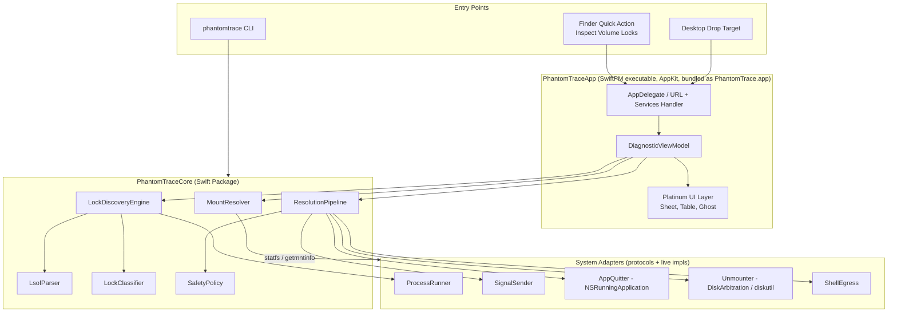
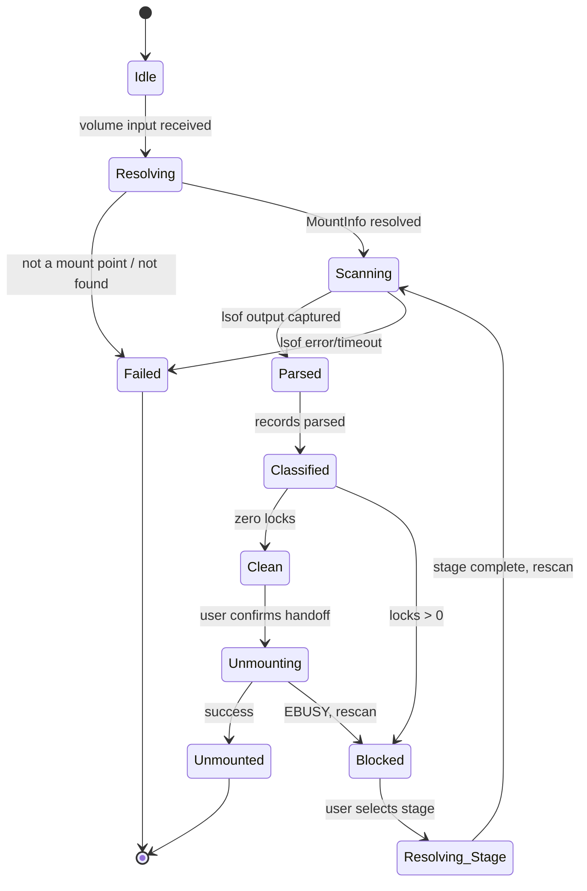
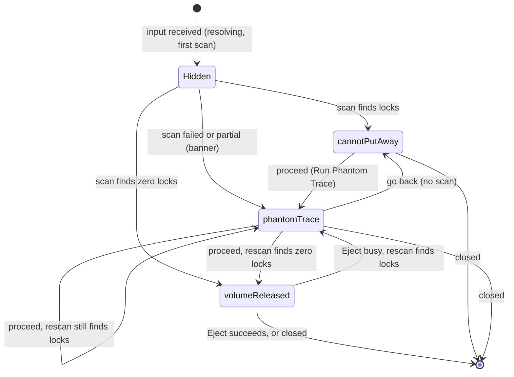
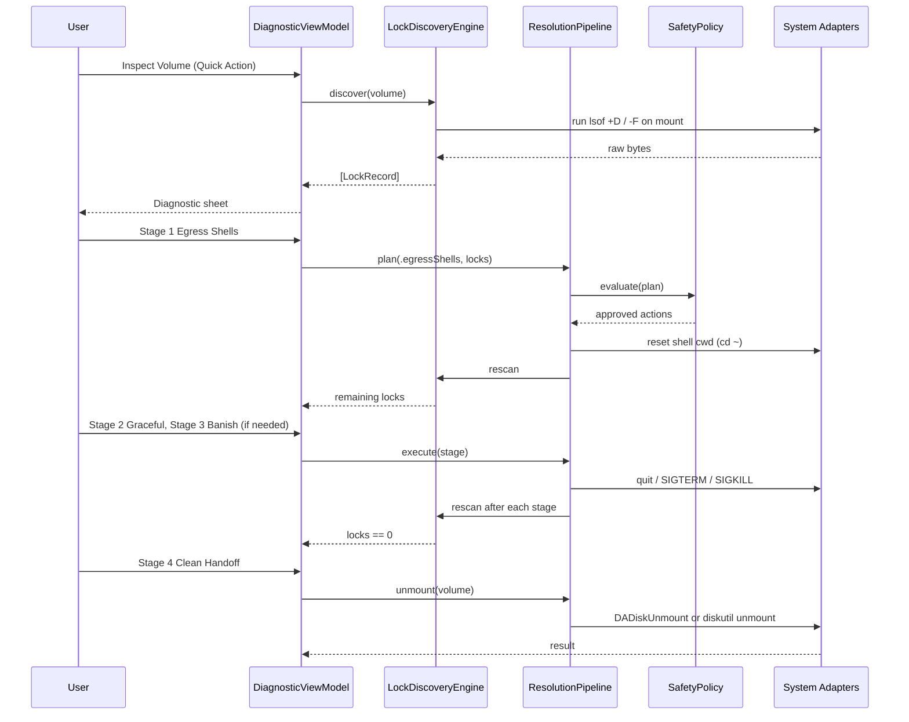
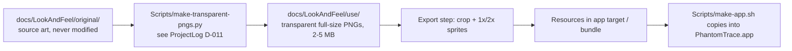

# Design Document: PhantomTrace — Volume Lock Forensics & Banishment

## Overview

PhantomTrace is a retro-themed macOS utility (targeting macOS 27.2.1 / build 26B131 or later) that answers the question Finder refuses to answer: "Which program is keeping this disk from ejecting?" Given a volume (external drive, USB stick, or mounted `.dmg`), it resolves the mount point, enumerates every process holding a lock on that volume, classifies each lock, and presents the result in a System 7 / Mac OS 9 Platinum-styled diagnostic sheet haunted by an original, Kiro-inspired ghost mascot (not the Kiro ghost). It resurrects classic "What's Keeping Me?" / Put Away inspector tools for modern Darwin and APFS (Hackathon category: Resurrection).

Locks are classified into three kinds: background system daemons (Spotlight `mds`, `mdworker_shared`, QuickLook satellites), CWD locks (idle shells such as `zsh`/`bash`/`node` whose current working directory sits inside the volume), and open file handles (apps with read/write descriptors on specific files). The user then walks a graduated resolution pipeline: (1) Egress Shells, (2) Graceful Request, (3) Banish Locks (targeted SIGKILL), (4) Clean Handoff (unmount via DiskArbitration or `diskutil`). Each stage is opt-in, previewed, and re-verified against fresh process discovery before the next, escalating only what is still blocking.

The UI is three Platinum window states, one per mockup in `docs/LookAndFeel/original/composed/`: CANNOT PUT AWAY (the disk is blocked, offers to run a trace), PHANTOM TRACE (lock table plus the choice of letting PhantomTrace act or handling the processes yourself), and VOLUME RELEASED (no locks remain, offers Eject or a Finder retry). Each window has its own illustration and its own ghost colour (yellow, red, green). The window state is derived from the discovery state plus a little UI-only state (see Window States).

The system is implemented in Swift and built entirely with Swift Package Manager (core library, CLI, and a programmatic AppKit executable target), plus a Finder Quick Action. Full Xcode.app is not installed on the development machine (Command Line Tools only), so there is no `.xcodeproj`, no Interface Builder, no SwiftUI previews, and no asset catalog. `Scripts/make-app.sh` assembles the `.app` bundle from the SwiftPM build output. The core is pure and testable: parsers and classifiers are pure functions fuzzed with property-based tests; all system effects (spawning `lsof`, sending signals, unmounting) are behind protocols so they can be mocked. The project is developed spec-first with Kiro (`.kiro/specs`, steering, and hooks).

## Architecture



Layering rules: `PhantomTraceCore` imports only Foundation (and Darwin/DiskArbitration inside live adapters). It never imports AppKit. The UI depends on Core; Core never depends on UI.

### Discovery State Machine



### Window States (confirmed UI)

Three window states are confirmed. They are a presentation layer over the discovery state machine above; they do not add discovery states.

| Window state | Title plaque | Mockup | Illustration | Ghost | Shown when |
|---|---|---|---|---|---|
| `cannotPutAway` | CANNOT PUT AWAY | `composed-cannot put away.jpg` | `shackled-volume-and-padlocks.png` | `ghost-looking-left-yellow.png` | Volume resolved and the first scan reports locks (entry into Blocked_State) |
| `phantomTrace` | PHANTOM TRACE | `composed-phantom trace.jpg` | `crt-diagnostic-portal.png` | `ghost-looking-left-red.png` | The user proceeds from `cannotPutAway`; also while rescanning, while a stage runs, and after a rescan that still finds locks |
| `volumeReleased` | VOLUME RELEASED | `composed-volume released.jpg` | `shattered-chains-and-portullis.png` | `ghost-looking-left-green.png` | A fresh scan reports zero locks, or the volume has been unmounted |

Content of each window (the content area of the mockups is empty; the app draws it):

- `cannotPutAway`: a spooky message that the disk cannot be put away, a question asking whether to run a Phantom Trace, and one proceed button reading "Summon the Phantom Trace" (and the close box).
- `phantomTrace`: the lock table (Process Name, PID, User, Lock Category, File Path); a choice between "Let PhantomTrace act" (with the graduated stages Egress Shells, Graceful Request, Banish Locks to pick from) and "I'll deal with these processes myself"; one proceed button reading "Proceed, if you dare" (it reads "Conjuring..." while a stage runs); and a Go Back button reading "Retreat to the Shadows" at the footer's leading edge. Proceed runs the chosen stage (if any, after the Safety_Policy preview and, for Banish Locks, explicit confirmation) and then always triggers a fresh rescan. Under the Banish Locks option a small, indented, dark-red (sRGB 0.5, 0, 0) label reads "Beware: this force-stops programs. Unsaved changes to open files may be lost forever." The meaning is carried by the words, not by color alone, and the same text is the option's accessibility help (Requirement 18.32; the confirmation is Requirement 9.7). The Banish confirmation dialog states that unsaved changes may be lost, including changes to files open on this volume.
- Go Back (owner decision, 2026-11-12; Requirements 18.15, 18.27, 18.28, 18.29, supersedes the earlier provisional "no control returns from `phantomTrace` to `cannotPutAway`"): appears only in the `phantomTrace` window (never in `cannotPutAway` or `volumeReleased`). Activating it returns to `cannotPutAway` with the same Lock_Records; it runs no scan, sends no signal, clears the Phantom_Choice selection, and clears the Proceeded_Flag. It is shown and enabled only when the window is `phantomTrace`, there is at least one lock, and no stage is running; it is hidden while a stage runs and ignored while any operation is in flight. Pressing Proceed in `cannotPutAway` afterwards shows `phantomTrace` again (no scan, as before). Rejected alternatives: Go Back also in `volumeReleased`; rescanning on Go Back. Implementation: Core `PhantomControls.goBackEnabled` and `DiagnosticCoordinator.goBack()`; UI `ActionButton.goBack`.
- Button text: every button has spooky microcopy plus accessibility help that states plainly what it does (Requirement 18.31). Shipped help text: Go Back: "Returns to the Cannot Put Away window. Nothing is scanned or stopped."; Proceed in `cannotPutAway`: "Shows which programs are holding the volume."; Proceed in `phantomTrace`: "Runs the option you chose, then scans the volume again." Proceed labels are "Summon the Phantom Trace", "Proceed, if you dare", and "Conjuring..." while a stage runs (Requirement 18.30).
- `volumeReleased`: a spooky message on how to proceed. If the volume is still mounted: an Eject button (runs Clean Handoff, Stage 4) together with a note that retrying Eject in Finder also works. If the volume is already unmounted: the message and instruction only, no Eject button.

```swift
public enum WindowState: Equatable, Sendable { case cannotPutAway, phantomTrace, volumeReleased }

public enum PhantomChoice: Equatable, Sendable {
    case letPhantomTraceAct(ResolutionStage)  // .egressShells, .gracefulRequest, .banishLocks
    case handleMyself
}

public struct WindowModel: Equatable, Sendable {
    public var window: WindowState
    public var ghost: GhostState            // derived from window, never set independently
    public var locks: [LockRecord]
    public var isScanning: Bool             // progress overlay inside the current window
    public var banner: Banner?              // failed / partial discovery (Requirement 14)
    public var volumeStillMounted: Bool
    public var choice: PhantomChoice?       // only meaningful in .phantomTrace
}

public enum GhostState: Equatable, Sendable { case yellow, red, green }  // all left-facing
```

Transitions:



Mapping from discovery state to window:

| Discovery state | Window state | Notes |
|---|---|---|
| Idle | none | No window content until input arrives |
| Resolving / first Scanning | none ("Hidden"), or the frame with a scanning overlay if the scan exceeds 500 ms | See open question 1 |
| Resolving → Failed (protected volume, not a mount point, cannot verify) | none | Alert only (Requirement 2); no lock window is shown |
| Scanning → Failed or Partial (lsof error, timeout) | `phantomTrace` with failure banner and Rescan button | Empty or partial table, stage choices disabled (Requirement 14); see open question 2 |
| Blocked, first result | `cannotPutAway` | Ghost yellow |
| Blocked, after the user proceeded | `phantomTrace` | Ghost red; also during stage execution and rescans (table dimmed, progress shown, proceed disabled) |
| Clean | `volumeReleased` | Ghost green; Eject button if volume still mounted |
| Unmounting | `volumeReleased` (progress on the Eject button) | Eject disabled while running |
| Unmounted | `volumeReleased` | Eject button hidden; message confirms the release |
| Unmounting → Blocked (EBUSY) | `phantomTrace` | Newly found locks shown; ghost red |

If the volume becomes unmounted at any time (the user ejected it in Finder, or it was removed), the next scan or mount-table check moves to `volumeReleased` with `volumeStillMounted = false`, from any window. Scan-in-progress never changes the window or ghost; it only sets `isScanning`.

Go Back is an explicit user event, not a discovery transition: `DiagnosticCoordinator.goBack()` sets the window to `cannotPutAway` directly, keeps `locks`, sets `choice = nil`, and clears the Proceeded_Flag. The "current = phantomTrace" stickiness in `selectWindow` applies only to results of scans and stages, so it does not undo a Go Back. `PhantomControls.goBackEnabled` is true only when the window is `phantomTrace`, `locks` is non-empty, and no stage is running.

Selection rule (pure, testable):

```pascal
ALGORITHM selectWindow(discovery, proceeded, current)
INPUT: discovery state, proceeded flag (user pressed proceed in cannotPutAway), current window
OUTPUT: WindowState or HIDDEN

BEGIN
  CASE discovery OF
    Clean, Unmounting, Unmounted: RETURN volumeReleased
    Blocked:
      IF proceeded OR current = phantomTrace THEN RETURN phantomTrace
      RETURN cannotPutAway
    Failed or Partial after scan:   RETURN phantomTrace
    Scanning:                       RETURN current       // unchanged; HIDDEN if none yet
    Idle, Resolving, Failed (resolve): RETURN HIDDEN
  END CASE
END

ALGORITHM ghostFor(window)
  cannotPutAway -> yellow; phantomTrace -> red; volumeReleased -> green
END
```

This replaces the earlier Ghost_State mapping (idle/scanning, haunting, banished). The three sprite states are now defined by the window, not by raw discovery state.

### Resolution Pipeline Sequence



## Components and Interfaces

### Component 1: MountResolver

**Purpose**: Turn arbitrary user input (Finder-selected URL, dropped file, path inside a volume, `.dmg`) into a canonical `MountInfo`.

**Interface**:
```swift
public protocol MountResolving {
    func resolve(_ input: URL) throws -> MountInfo
    func allMounts() throws -> [MountInfo]
}
```

**Responsibilities**:
- Canonicalize via `realpath` / `resolvingSymlinksInPath` (handles `/Volumes/X` symlinks and firmlinks such as `/System/Volumes/Data`)
- Use `getmntinfo`/`statfs` to find the owning mount (longest-prefix match on `f_mntonname`)
- Map a mounted `.dmg` file to its attached volume (via `hdiutil info -plist` or DiskArbitration description)
- Refuse the root volume and system volumes (`/`, `/System/Volumes/*`, `/private/var/vm`)

### Component 2: LockDiscoveryEngine

**Purpose**: Produce the authoritative, current list of `LockRecord`s for a volume.

**Interface**:
```swift
public protocol LockDiscovering {
    func discover(on volume: MountInfo) async throws -> [LockRecord]
}
```

**Responsibilities**:
- Run `/usr/sbin/lsof -F pcLnftau0 -w +f -- <mountpoint>` through `ProcessRunner` with a timeout (machine-readable NUL-terminated field output)
- Fall back to `lsof +D` and `fuser -c` cross-check when output is truncated or `lsof` times out
- Hand bytes to `LsofParser`, then to `LockClassifier`
- Merge duplicate (pid, path) rows; drop PhantomTrace's own PID

### Component 3: LsofParser

**Purpose**: Pure, total parser of `lsof -F` output into `RawLsofRecord`s. Never throws on malformed input; surfaces warnings instead.

**Interface**:
```swift
public enum LsofParser {
    public static func parse(_ data: Data) -> ParseResult
}

public struct ParseResult: Equatable {
    public var records: [RawLsofRecord]
    public var warnings: [ParseWarning]
}
```

**Responsibilities**:
- Operate on raw bytes (not `String`) so non-UTF8 paths survive
- Decode `lsof` octal/hex escapes (`\x20`, `\\`) in names
- Handle paths with spaces, newlines, symlinks, trailing ` (deleted)`-style annotations, and truncated tail records
- Be deterministic and idempotent; ignore unknown field letters

### Component 4: LockClassifier

**Purpose**: Assign each `RawLsofRecord` a `LockCategory` and `ProcessRole`.

**Interface**:
```swift
public protocol LockClassifying {
    func classify(_ raw: RawLsofRecord, volume: MountInfo) -> LockRecord?
}
```

**Responsibilities**:
- `fd == "cwd"` → `.cwd`; numeric/`txt`/`mem` fds → `.openFileHandle`
- Command/path allowlist for `.systemDaemon` (`mds`, `mds_stores`, `mdworker_shared`, `QuickLookSatellite`, `fseventsd`, `corespotlightd`, `diskimages-helper`)
- Shell detection (`zsh`, `bash`, `fish`, `sh`, `dash`, `tcsh`) for egress eligibility; idle if foreground process group of its TTY is the shell itself
- Confirm path is actually under the volume mount (symlink-aware)

### Component 5: ResolutionPipeline

**Purpose**: Execute graduated, previewable, re-verified resolution stages.

**Interface**:
```swift
public protocol ResolutionPipelining {
    func plan(_ stage: ResolutionStage, locks: [LockRecord]) -> ResolutionPlan
    func execute(_ plan: ResolutionPlan, on volume: MountInfo) async -> StageOutcome
}
```

**Responsibilities**:
- Stage 1 Egress Shells: reset an idle shell's cwd without killing it
- Stage 2 Graceful Request: `NSRunningApplication.terminate()` for GUI apps, `SIGTERM` for CLI processes, then wait with grace timeout
- Stage 3 Banish Locks: `SIGKILL` only for hung daemons and orphan workers that survive stage 2 and pass `SafetyPolicy`
- Stage 4 Clean Handoff: unmount only when lock count is zero (re-verified immediately before)
- Rescan after every stage; never carry stale state forward

### Component 6: SafetyPolicy

**Purpose**: Central gate that decides which actions are allowed.

**Interface**:
```swift
public protocol SafetyPolicying {
    func evaluate(_ action: ProposedAction, context: SafetyContext) -> SafetyVerdict
}
```

**Responsibilities**:
- Deny PID 0/1, `launchd`, `kernel_task`, `WindowServer`, `loginwindow`, `Finder`, PhantomTrace itself, and processes owned by other users unless authorized
- Deny SIGKILL unless process is a known-safe category or user has explicitly confirmed per-process
- Enforce stage ordering (cannot Banish before Graceful has been attempted on that PID)
- Guard against PID reuse by verifying (pid, start time) identity immediately before signalling

### Component 7: Unmounter

**Purpose**: Perform the final unmount.

**Interface**:
```swift
public protocol Unmounting {
    func unmount(_ volume: MountInfo, force: Bool) async throws
}
```

**Responsibilities**:
- Primary: `DADiskCreateFromVolumePath` + `DADiskUnmount` with `kDADiskUnmountOptionDefault`
- Fallback: `/usr/sbin/diskutil unmount <mountpoint>` (argument array, no shell)
- Map `kDAReturnBusy`/`EBUSY` back to `Blocked` state; optional `eject` for the whole disk afterward
- Never use force unmount unless the user explicitly requests it in an advanced confirmation

### Component 8: Entry Points

**Purpose**: Get the user into the diagnostic sheet from Finder without a menu-bar widget.

**Responsibilities**:
- Finder Quick Action: a hand-written Automator-style `.workflow` bundle (plain `Info.plist` and `document.wflow` property lists, no Xcode tooling) and/or an `NSServices` entry in the app's `Info.plist`, named "Why Can't I Eject?" / "Inspect Volume Locks". Either route passes the selected item to `phantomtrace://inspect?path=<percent-encoded>`. App Intents are not used because they need Xcode's metadata extraction tooling. `Scripts/install-quick-action.sh` copies the workflow to `~/Library/Services` and refreshes Services (`/System/Library/CoreServices/pbs -flush`). Which of the two routes ships is decided by manual testing in Finder; both are cheap to keep.
- Desktop drop target: a small, non-menu-bar window/Dock icon accepting dropped volume icons or folders
- URL scheme: the app bundle's `Info.plist` declares `CFBundleURLTypes` for `phantomtrace`; the handler runs in `AppDelegate` (`application(_:open:)`)
- `phantomtrace` CLI for scripting and for end-to-end tests
- App main menu and volume picker (added; see Component 8a below and Requirement 19)

**Clarification of "no menu-bar widget"**: the phrase "no menu-bar item" in this document means no status-bar extra: the app never creates an `NSStatusItem` or any system menu-bar widget. It does not mean the app has no main menu. The app has a normal programmatic main menu (App, File, Window) shown while it is the active application.

### Component 8a: App Main Menu and Volume Picker (Requirement 19)

**Purpose**: Give the user a way to choose a disk from inside the app (previously only Quick Action, URL, and drop worked), and provide the standard Quit/Close/Hide commands that were missing because the app set no main menu.

**Layering**: `VolumeLister` and `VolumeListEntry` live in `PhantomTraceCore/Mounts` (pure, no I/O). `MountedVolumeEnumerating` and its live adapter live in `PhantomTraceCore/System`. The menu builder, volume list view, and notification observers live in the AppKit app/UI targets (`Sources/PhantomTraceApp`, `Sources/PhantomTraceUI`). Dependencies still point App/UI -> Core.

**Main menu (programmatic `NSMenu`, set via `NSApplication.mainMenu` in `AppDelegate`; no `.xib`)**:

| Menu | Items |
|------|-------|
| PhantomTrace | About PhantomTrace; separator; Hide PhantomTrace (Cmd-H); Hide Others (Opt-Cmd-H); Show All; separator; Quit PhantomTrace (Cmd-Q) |
| File | Inspect... (Cmd-O); Inspect Volume (submenu of mounted volumes); separator; Close Window (Cmd-W) |
| Window | Minimize (Cmd-M); Bring All to Front |

- Standard actions use the responder-chain selectors (`orderFrontStandardAboutPanel:`, `hide:`, `hideOtherApplications:`, `unhideAllApplications:`, `terminate:`, `performClose:`, `performMiniaturize:`, `arrangeInFront:`). `NSApplication.windowsMenu` is set to the Window menu so AppKit maintains it.
- Inspect... opens an `NSOpenPanel` with `canChooseFiles`, `canChooseDirectories` both true, `allowsMultipleSelection` false, and `showsHiddenFiles` default. The chosen URL is passed to `InspectRequestRouter.handle(url:)`; cancelling does nothing. The panel only selects; it performs no scan itself.
- Inspect Volume submenu is rebuilt from the current `[VolumeListEntry]` (same data as the window list). Each item title is the volume name with the mount point as a secondary line (`NSMenuItem.toolTip` and `attributedTitle`) and a removable/ejectable marker. An empty list shows one disabled item "No volumes available to inspect". The submenu lists the entries in the same order as the window list. The item's `representedObject` is the mount-point path string.
- Menu validation (`validateMenuItem`): Close Window is disabled when no window is key. Inspect... and Inspect Volume stay enabled except while the router has a request in flight.
- No `NSStatusItem` is created anywhere.

**Volume list in the drop window**: the drop window (shown when the Dock icon is clicked with no windows open, and at launch when the app was opened directly with no URL or file input) shows, beside the drop target, a list of mounted volumes. At launch with no input item (no `phantomtrace://` URL, no opened file, no dropped item), the window is shown with the current list within 2000 ms of launch completing and no scan starts. Cmd-W closes the window without quitting and without cancelling a running inspect flow; File > Inspect... or reactivation with no visible window can show it again. If the list is empty, the window shows "No volumes available to inspect" in place of the list and the drop area and File > Inspect... stay operable. Each row shows:
- Volume name (the localized volume name reported by the file system for the mount point; if unavailable or empty, the last path component of the mount point) and mount point (middle-truncated per Property 19, full path in tooltip and accessibility value)
- A removable/ejectable indicator (text label "Removable" for a mount the system reports as removable or ejectable, "Internal" otherwise, plus a small glyph; never color alone)
- An "Inspect" button

Selecting Inspect on a row, double-clicking the row, or pressing Return on a selected row calls `InspectRequestRouter.handle(path: entry.mountPoint.path)`, the same call a drop of that mount point makes. The list view and the menu never call adapters, never invoke `MountResolver` directly, and start no scan except the normal inspect flow that the router triggers after `InspectURLParser` accepts the request. A rejection (for example the volume disappeared) is reported through the router's existing `onRejected` path.

**Refresh**: the app target observes `NSWorkspace.didMountNotification`, `NSWorkspace.didUnmountNotification`, and `NSWorkspace.didRenameVolumeNotification` on `NSWorkspace.shared.notificationCenter`. Each notification triggers one off-main-actor enumeration (`MountedVolumeEnumerating.enumerate()`), then `VolumeLister.list` runs on the result and the main actor swaps the list and rebuilds the submenu. Notifications are coalesced with a 500 ms debounce window that restarts on each event (via an injected clock/scheduler), so a burst causes one refresh, completed within 1000 ms after the last event. The list also refreshes when the drop window is shown. Enumeration failure leaves the previous list in place and shows "Couldn't read the list of volumes" in the window; the drop target keeps working; a later successful enumeration removes the message and shows the new list.

**Accessibility**: each row is one accessibility element with label "<name>, <mount point>, <removable|internal>"; the Inspect button has label "Inspect <name>"; the list supports arrow-key navigation, Tab reaches the list and the buttons, Space/Return activates the focused button. All menu items have standard key equivalents. Reduce Motion is honored (no animated list updates).

**Interface**:
```swift
// Core/System (protocol) - live adapter uses FileManager.mountedVolumeURLs(includingResourceValuesForKeys:options: .skipHiddenVolumes)
// with resource values volumeNameKey, volumeIsRemovableKey, volumeIsEjectableKey, or the existing getmntinfo-based mount table provider.
public protocol MountedVolumeEnumerating: Sendable {
    func enumerate() throws -> [MountInfo]
}

// Core/Mounts (pure)
public struct VolumeListEntry: Equatable, Hashable, Sendable {
    public let mountPoint: URL        // canonical
    public let displayName: String    // MountInfo.volumeName, never empty
    public let isRemovable: Bool      // removable or ejectable
    public let isDiskImage: Bool
}

public enum VolumeLister {
    /// Pure. No I/O.
    public static func list(_ mounts: [MountInfo]) -> [VolumeListEntry]
}
```

**VolumeLister.list rules** (pure; applies in this order):
1. Drop any mount for which `MountResolver.isProtected(mountPoint)` is true (`/`, `/System/Volumes/...`, `/private/var/vm`, and any mount point that is empty or unverifiable). The same function the resolver uses is reused, not reimplemented.
2. Drop hidden/system mounts: file system type in `{devfs, autofs, nullfs, fdesc, procfs}`; device node not beginning with `/dev/` (for example `map auto_home`); mount point whose last component is `com.apple.TimeMachine.localsnapshots` or that lies under such a directory; mount points under `/private/var`; and mount points whose last component begins with `.`.
3. De-duplicate by canonical mount point (lexically normalized; first occurrence by sorted order wins, so the result does not depend on input order; when duplicates differ, the one with the lexicographically smallest `(volumeName, deviceNode)` wins).
4. Map to `VolumeListEntry`, with `isRemovable = mount.isRemovable` (disk images carry their own `isDiskImage` flag; the live adapter sets `isRemovable` from `volumeIsRemovableKey || volumeIsEjectableKey`) and `displayName` falling back to the last path component when `volumeName` is empty.
5. Sort by `displayName` (case-insensitive, then case-sensitive, using byte-wise comparison of the NFC string, so locale does not matter), then by `mountPoint.path` bytes.

**Failure behavior**: unknown or undeterminable attributes mean exclude (consistent with the deny-by-default rule in safety.md). Listing a volume is not approval to act on it; `SafetyPolicy` and `MountResolver` still gate everything after the request is routed.

**Requirement 19 ("Volume picker and app menu")**: defined in `requirements.md`. Criteria 19.1-19.10 below are a summary and match the numbering there; 19.11 (enumeration failure), 19.12 (router rejection), 19.13 (empty list message), 19.14 (launch with no input), and 19.15 (Close Window) are additional criteria in `requirements.md`. Properties 23-29 cite these numbers.
- 19.1 The app SHALL set a main menu (PhantomTrace, File, Window) and SHALL NOT create an `NSStatusItem`.
- 19.2 File > Inspect... (Cmd-O) SHALL open a panel choosing files, folders, or volumes and route the choice through `InspectRequestRouter`.
- 19.3 The drop window SHALL show a list of mounted volumes, each with name, mount point, removable indicator, and an Inspect button; the same list SHALL feed File > Inspect Volume.
- 19.4 The list SHALL exclude protected volumes per Requirement 2.
- 19.5 The list SHALL exclude hidden and system mounts.
- 19.6 The list SHALL contain each mount point at most once and every non-excluded mount.
- 19.7 The list order SHALL be deterministic (display name, then mount point) and independent of input order.
- 19.8 Selecting a list or menu entry SHALL behave exactly like dropping that mount point, with no adapter calls and no extra scan.
- 19.9 The list and submenu SHALL refresh on volume mount, unmount, and rename.
- 19.10 List rows and buttons SHALL have VoiceOver labels and be keyboard operable.

**Testing notes** (per `testing.md`): `VolumeLister` gets unit tests and the property tests above in `PhantomTracePropertyTests` (generators: mount tables with duplicates, protected paths, hidden types, shuffled order; 500+ iterations). `MountedVolumeEnumerating` is mocked; the live adapter is not tested against the real mount table. Property 28 uses a recording router/closure pair in `PhantomTraceCoreTests` or the UI test target, and Property 29 inspects the built `NSMenu` structure in the app/UI target without launching the app. Menu building and notification wiring are manual-QA items in `docs/` (Cmd-Q, Cmd-W, Cmd-O, mount/unmount refresh with a throwaway `.dmg`, VoiceOver, keyboard navigation).

### Component 9: Platinum UI Layer

**Purpose**: Render the diagnostic sheet in System 7 / Mac OS 9 Platinum Retro Gothic style.

**Responsibilities**:
- Programmatic AppKit only: views, windows, and menus are built in code (no `.xib`/`.storyboard`, no SwiftUI previews)
- Custom-drawn window chrome: pinstripe title bar, 1px beveled frames, square close/zoom boxes. Flat non-art chrome keeps the pinstripe/bevel look. Where reference art frames the window, it is drawn as a 9-slice or with a content cutout (see Asset Pipeline)
- Interior background (owner decision, 2026-11-12; replaces platinum #DDDDDD, Requirement 13.9): in art mode the content area is filled from the window art's own center slice (high-quality interpolation). When the art is missing, the fallback is a flat art-center gray, sRGB 193/193/188. The lock table is transparent (no table, scroll, or clip background, and no header corner square) so rows sit on the same gray (Requirement 13.9)
- Close box: in art mode it is a transparent 25x25 pt overlay on the X square drawn in the frame art (at 11,11 from the window's top-left). It darkens on press and keeps a focus ring (Requirement 13.15)
- Lock window layout (owner decision, 2026-11-12): the chrome is 760x600 pt. The NSWindow is non-opaque with a clear background and 51 pt wider than the chrome, so the Ghost_Mascot (153x170 pt, 40 pt from the top) sits near the top right with about one third outside the chrome over transparency, on all three windows. The illustration is a 150 pt box inset 78 pt from the chrome's right and bottom (above and left of the skull frame corner). The footer keeps 106 pt of right clearance and the lock table stays above the illustration. The lock window opens to the right of the main (drop) window, tops aligned, with a 10 pt gap; it is centered if the main window is not visible, and clamped to the screen's visible frame (Requirements 13.16-13.19: ghost placement, illustration placement, lock window placement, and the five-column fit)
- Lock table columns: all five columns (Process Name, PID, User, Lock Category, File Path) fit the 760 pt chrome. File Path takes the remaining width and middle-truncates
- Typography (see `docs/Assets.md`): table cells use Monaco, loaded by name from the system with `NSFont(name: "Monaco", size:)`, falling back to Menlo, then the system monospaced font. Monaco is never bundled. Titles use an optional bundled open-licensed bitmap title font (Chicago-style; not yet chosen), registered at launch from a bundle file with `CTFontManagerRegisterFontsForURL`. If that font file is absent or registration fails, titles use a system font. Apple font files (Monaco, Menlo, SF, Chicago) are never committed or bundled
- The drop window's mounted-volume list (Component 8a) uses the same Platinum styling as the rest of the window: Monaco rows, beveled 1px list frame, platinum selection highlight, square-edged Inspect buttons
- Table columns: Process Name, PID, User, Lock Category, File Path (with middle truncation and tooltip for full path)
- Three window states (CANNOT PUT AWAY, PHANTOM TRACE, VOLUME RELEASED), selected by `selectWindow` from the discovery state (see Window States). One window is on screen at a time; a state change swaps the illustration, ghost, title plaque, and content
- In PHANTOM TRACE: a choice control (PhantomTrace acts with stage 1, 2, or 3 / I'll handle it myself) and one proceed button with a progress state; stage choices that do not apply are disabled. Clean Handoff is not a choice here; it is the Eject button in VOLUME RELEASED
- Kiro-inspired ghost mascot (original character, not the Kiro ghost): left-facing glowing sprite whose colour follows the window: yellow (CANNOT PUT AWAY), red (PHANTOM TRACE), green (VOLUME RELEASED)
- Accessibility: VoiceOver labels on all custom controls, Reduce Motion respected for glow animation, sufficient contrast

## Build, Packaging, and Asset Pipeline

### Build and bundling (SwiftPM only)

The environment has Command Line Tools only (macOS 27.2.1). Nothing in the design may require Xcode.app, `xcodebuild`, `actool`, or Interface Builder.

- The app is a SwiftPM `.executableTarget` (`PhantomTraceApp`) that depends on `PhantomTraceCore`. `swift build -c release` produces the binary.
- `Scripts/make-app.sh` assembles `PhantomTrace.app`:

```pascal
ALGORITHM makeApp(config)
BEGIN
  swift build -c config
  bundle ← "build/PhantomTrace.app"
  CREATE bundle/Contents/MacOS, bundle/Contents/Resources
  COPY .build/config/PhantomTraceApp TO bundle/Contents/MacOS/PhantomTrace
  WRITE bundle/Contents/Info.plist       // CFBundleExecutable, CFBundleIdentifier, LSMinimumSystemVersion 27.2.1,
                                         // CFBundleURLTypes (scheme "phantomtrace"), optional NSServices entry
  COPY App sprites (1x/2x PNG) TO bundle/Contents/Resources
  IF an open-licensed title font file exists in Resources/Fonts THEN
    COPY the font file AND its license file TO bundle/Contents/Resources   // optional; never Apple fonts
  END IF
  codesign --force --options runtime --entitlements PhantomTrace.entitlements --sign identity bundle
  codesign --verify --strict bundle
END
```

- Signing uses the hardened runtime and minimal entitlements. No App Sandbox (it blocks `lsof` and signalling). Automation (Apple events) is declared only if Terminal scripting ships. An ad-hoc identity (`-`) is the default for local runs.
- Notarization with `xcrun notarytool submit --wait` and `xcrun stapler staple` is a documented, manual, optional step, not run by the script.
- Resources are plain files loaded at runtime from `Bundle.main.resourceURL`. SwiftPM `resources:` is not relied on for the shipped app, because the script owns the bundle layout. There is no `.xcassets`.
- Debugging uses `lldb` and `swift run`; the UI is exercised by launching the bundled app.

### Asset pipeline



- Source art stays in `docs/LookAndFeel/original/` and is never modified.
- Transparent full-size PNGs are produced into `docs/LookAndFeel/use/` by `Scripts/make-transparent-pngs.py` (flood-fill from the border, per-image `SEAL_RADIUS_OVERRIDES`; proofs via `Scripts/make-proof-sheets.py`).
- The app needs cropped 1x and 2x sprites exported from `use/` (full-size files are too large to ship). Naming is `name.png` and `name@2x.png`, kebab-case. Sprite loading composes an `NSImage` with both representations. The export script is a follow-up task and lives with the other Python tooling (pinned in `Scripts/requirements.txt`).
- `window.png` is opaque inside the frame. The window frame is therefore drawn as a 9-slice (fixed corners and edges, with the center region filled by the app from the art's own center slice, or flat art-center gray sRGB 193/193/188 when the art is missing; see Component 9) or by a content cutout that clears the interior. Slice insets are recorded alongside the sprite and used by a `NinePartImageView` (or `NSImage.capInsets` with `resizingMode = .stretch`). Content such as the table and buttons is placed in the cutout rectangle.

### Confirmed art-to-window mapping

The user confirmed three window states (see Window States). Mockups in `docs/LookAndFeel/original/composed/` are mood references; the app composes each window from the window frame, one illustration, and one ghost sprite.

| Window state | Illustration (from `use/`) | Ghost (from `use/`) | Mockup reference |
|---|---|---|---|
| `cannotPutAway` | `shackled-volume-and-padlocks.png` | `ghost-looking-left-yellow.png` | `composed-cannot put away.jpg` |
| `phantomTrace` | `crt-diagnostic-portal.png` (source `original/base-images/base-crt diagnostic portal.jpg`) | `ghost-looking-left-red.png` | `composed-phantom trace.jpg` |
| `volumeReleased` | `shattered-chains-and-portullis.png` | `ghost-looking-left-green.png` | `composed-volume released.jpg` |

All three windows share one window frame (`window.png`), drawn as a 9-slice. The title plaque text (CANNOT PUT AWAY, PHANTOM TRACE, VOLUME RELEASED) is drawn by the app in the bundled bitmap title font when one is available, otherwise in a system font, and is not baked into the frame.

Sprite set to export (cropped, 1x and 2x, kebab-case, plain files in `Contents/Resources`, no asset catalog):

| Sprite file | Used by |
|---|---|
| `window-frame.png`, `window-frame@2x.png` (+ recorded 9-slice insets) | all three windows |
| `shackled-volume-and-padlocks.png`, `@2x` | `cannotPutAway` |
| `crt-diagnostic-portal.png`, `@2x` | `phantomTrace` |
| `shattered-chains-and-portullis.png`, `@2x` | `volumeReleased` |
| `ghost-looking-left-yellow.png`, `@2x` | `cannotPutAway` |
| `ghost-looking-left-red.png`, `@2x` | `phantomTrace` |
| `ghost-looking-left-green.png`, `@2x` | `volumeReleased` |

`ghost-looking-right-yellow` is not part of the sprite set. No window uses a right-facing ghost; it may be added later only if a stated purpose appears (for example a scanning overlay).

Reduce Motion: each sprite is shown static with no glow animation. If a sprite is missing or cannot be decoded, a text or system-drawn substitute is shown and the window keeps working (Requirement 17.7).

### Open items

- Unresolved UI questions (not guessed; proposals above are provisional):
  1. What is shown during the first resolve and scan, before any of the three confirmed windows applies? No mockup exists. Provisional: show nothing until the result (target under 2 s), or the window frame with a scanning overlay after 500 ms.
  2. Which window shows a failed or partial scan (lsof error or timeout)? Provisional: PHANTOM TRACE with a failure banner, Rescan button, and stage choices disabled.
  3. When exactly does VOLUME RELEASED show the Eject button versus only the "retry in Finder" instruction? Provisional: Eject button plus a Finder-retry note while the volume is mounted; instruction only once it is unmounted.
  4. Does "I'll deal with these processes myself" need a wait or hint (for example, per-process steps)? Provisional: just the process list and a Rescan via the proceed button.
  5. Can the user return from PHANTOM TRACE to CANNOT PUT AWAY? Resolved by owner decision (2026-11-12), superseding the earlier provisional answer ("no, close and reopen"): yes, through the Go Back button ("Retreat to the Shadows"), which runs no scan (Requirement 18.15).
- Provenance and license of the look-and-feel art are recorded in [docs/Assets.md](../../../docs/Assets.md) (see also `docs/LookAndFeel/README.md`); its "To confirm" fields must be filled before submission.
- Do a side-by-side check of the Kiro-inspired ghost mascot against the official Kiro ghost, and record the result and date in `docs/Assets.md`. If any pose looks too close, regenerate or replace it.
- The Chicago-style bitmap title font is not chosen. It is optional: if one is picked, it needs an open license (for example SIL OFL), with its license file stored next to it and a row in `docs/Assets.md`. Without it, titles use a system font. Monaco is a system font and is not bundled.
- The app icon is pending (no icon exists yet); add its row to `docs/Assets.md` when it is created.

## Data Models

### MountInfo

```swift
public struct MountInfo: Equatable, Hashable, Sendable {
    public let mountPoint: URL        // canonical, e.g. /Volumes/BACKUP
    public let volumeName: String     // display name
    public let deviceNode: String     // e.g. /dev/disk4s1
    public let fileSystemType: String // apfs, hfs, exfat, msdos, ...
    public let isInternal: Bool
    public let isRemovable: Bool
    public let isDiskImage: Bool
}
```

**Validation Rules**:
- `mountPoint` is absolute, canonical, and exists in the current mount table
- `mountPoint` is not `/` and not under `/System/Volumes`
- `volumeName` non-empty (falls back to last path component)

### RawLsofRecord

```swift
public struct RawLsofRecord: Equatable, Sendable {
    public var pid: Int32
    public var command: String           // lossy UTF-8 for display
    public var commandBytes: Data
    public var user: String?             // login name or uid string
    public var fd: String                // "cwd", "txt", "3r", "12u", ...
    public var accessMode: AccessMode?   // r, w, u
    public var fileType: String?         // REG, DIR, ...
    public var pathBytes: Data           // raw, exact bytes
    public var path: String              // lossy display form
}
```

**Validation Rules**:
- `pid > 0`
- `pathBytes` non-empty for emitted records
- `path` is derived from `pathBytes` using lossy decoding with U+FFFD; `pathBytes` is the source of truth

### LockRecord

```swift
public enum LockCategory: String, Sendable { case cwd, openFileHandle }

public enum ProcessRole: String, Sendable {
    case systemDaemon, idleShell, userApplication, cliTool, unknown
}

public struct LockRecord: Identifiable, Equatable, Sendable {
    public let id: UUID
    public let pid: Int32
    public let processName: String
    public let user: String
    public let category: LockCategory
    public let role: ProcessRole
    public let path: String
    public let pathBytes: Data
    public let accessMode: AccessMode?
    public let processStart: Date?   // identity guard against PID reuse
}
```

### ResolutionStage / Plan / Outcome

```swift
public enum ResolutionStage: Int, Comparable, Sendable {
    case egressShells = 1, gracefulRequest, banishLocks, cleanHandoff
}

public enum ProposedActionKind: Sendable {
    case resetShellCwd, quitApplication, sendSIGTERM, sendSIGKILL, unmount
}

public struct ProposedAction: Equatable, Sendable {
    public let kind: ProposedActionKind
    public let target: ProcessIdentity?   // (pid, startTime)
    public let reason: String
}

public struct ResolutionPlan: Equatable, Sendable {
    public let stage: ResolutionStage
    public let actions: [ProposedAction]
    public let skipped: [(LockRecord, SafetyDenial)]
}

public struct StageOutcome: Sendable {
    public let stage: ResolutionStage
    public let succeeded: [ProposedAction]
    public let failed: [(ProposedAction, Error)]
    public let remainingLocks: [LockRecord]
}
```

### Error Model

```swift
public enum PhantomTraceError: Error, Equatable {
    case notAMountPoint(URL)
    case protectedVolume(URL)
    case lsofUnavailable
    case lsofTimedOut(seconds: Double)
    case permissionDenied(pid: Int32)
    case processIdentityChanged(pid: Int32)
    case unmountBusy
    case unmountFailed(code: Int32)
}
```

## Algorithmic Pseudocode (Swift)

### Key Functions with Formal Specifications

### Function 1: MountResolver.resolve(_:)

```swift
func resolve(_ input: URL) throws -> MountInfo
```

**Preconditions:**
- `input` is a file URL
- `input` refers to an existing path or a `.dmg` file

**Postconditions:**
- Returns `MountInfo` whose `mountPoint` is a path-prefix of `realpath(input)` (or the attached volume of a `.dmg`)
- The returned mount is the longest-prefix match among all current mounts
- Throws `protectedVolume` if the mount is `/` or a system volume; no mutation of system state

**Loop Invariants:** During longest-prefix search, `best` is the longest matching mount seen so far.

### Function 2: LsofParser.parse(_:)

```swift
static func parse(_ data: Data) -> ParseResult
```

**Preconditions:**
- `data` is any byte sequence (including empty, truncated, or non-UTF8)

**Postconditions:**
- Never traps or throws
- Every emitted record has `pid > 0` and non-empty `pathBytes`
- `parse(data)` is deterministic
- For well-formed input produced by `lsof -F pcLnftau0`, round-tripping a generated record set through a serializer then `parse` yields the original records
- Malformed fragments produce a `ParseWarning`, not a partial/garbage record

**Loop Invariants:**
- `cursor` is monotonically non-decreasing and ≤ `data.count`
- `currentProcess` is either nil or a fully valid process-set header

### Function 3: LockClassifier.classify(_:volume:)

```swift
func classify(_ raw: RawLsofRecord, volume: MountInfo) -> LockRecord?
```

**Preconditions:**
- `raw` came from `LsofParser`
- `volume` is a valid `MountInfo`

**Postconditions:**
- Returns `nil` iff `raw.pathBytes` does not resolve under `volume.mountPoint`
- `fd == "cwd"` ⟺ `category == .cwd`
- `role == .systemDaemon` only when command is in the daemon allowlist
- Pure: no I/O besides optional symlink resolution through an injected `FileSystemProbe`

### Function 4: SafetyPolicy.evaluate(_:context:)

```swift
func evaluate(_ action: ProposedAction, context: SafetyContext) -> SafetyVerdict
```

**Preconditions:**
- `context` carries current user uid, own PID, protected process list, and stage history

**Postconditions:**
- Returns `.deny` for any action targeting a protected PID or name regardless of stage
- Returns `.deny` for `sendSIGKILL` if no prior `sendSIGTERM`/`quitApplication` was attempted on that identity (unless role is `.systemDaemon` hung by user confirmation)
- Returns `.allow` only for processes owned by the current user (or when elevated authorization exists)

### Main Algorithms

#### Mount resolution

```pascal
ALGORITHM resolveMount(input)
INPUT: input URL
OUTPUT: MountInfo or error

BEGIN
  canonical ← realpath(input)
  IF canonical IS NULL THEN THROW notAMountPoint(input)

  IF canonical ENDS WITH ".dmg" THEN
    attached ← hdiutilAttachedVolumes()
    FOR each vol IN attached DO
      IF vol.imagePath EQUALS canonical THEN RETURN toMountInfo(vol)
    END FOR
    THROW notAMountPoint(input)
  END IF

  best ← NULL
  FOR each m IN getmntinfo() DO
    ASSERT best IS NULL OR length(best.mountPoint) >= 0
    IF isPathPrefix(m.mountPoint, canonical) THEN
      IF best IS NULL OR length(m.mountPoint) > length(best.mountPoint) THEN
        best ← m
      END IF
    END IF
  END FOR

  IF best IS NULL THEN THROW notAMountPoint(input)
  IF isProtected(best) THEN THROW protectedVolume(best.mountPoint)
  RETURN best
END
```

#### Lsof field parsing (state machine)

```pascal
ALGORITHM parseLsofF(data)
INPUT: data bytes
OUTPUT: ParseResult

BEGIN
  records ← []; warnings ← []
  proc ← NULL; file ← NULL
  cursor ← 0

  WHILE cursor < length(data) DO
    ASSERT proc IS NULL OR proc.pid > 0
    (tag, value, next) ← readField(data, cursor)
    // field = 1 tag byte, value bytes until NUL or LF; next > cursor guaranteed
    IF tag IS NULL THEN
      warnings.add(truncatedTail(cursor)); BREAK
    END IF
    cursor ← next

    CASE tag OF
      'p': flush(file, proc, records); file ← NULL
           pid ← parseInt(value)
           IF pid IS INVALID OR pid <= 0 THEN
             warnings.add(badPid(value)); proc ← NULL
           ELSE proc ← newProc(pid)
           END IF
      'c': IF proc ≠ NULL THEN proc.commandBytes ← unescape(value)
      'L': IF proc ≠ NULL THEN proc.user ← lossy(value)
      'u': IF proc ≠ NULL AND proc.user IS NULL THEN proc.user ← "uid:" + value
      'f': flush(file, proc, records)
           file ← newFile(fd = lossy(value))
      'a': IF file ≠ NULL THEN file.access ← parseAccess(value)
      't': IF file ≠ NULL THEN file.type ← lossy(value)
      'n': IF file ≠ NULL THEN file.pathBytes ← unescape(value)
      OTHERWISE: // unknown tag ignored
    END CASE
  END WHILE

  flush(file, proc, records)
  RETURN ParseResult(records, warnings)
END
```

**Preconditions:**
- `readField` always advances cursor by at least 1 byte

**Postconditions:**
- Each record is emitted at most once; `flush` emits only when `proc ≠ NULL` and `file.pathBytes` non-empty
- Terminates in O(n)

**Loop Invariants:**
- `cursor` strictly increases each iteration
- `file ≠ NULL` implies `proc ≠ NULL` at emission time

#### Staged resolution

```pascal
ALGORITHM runStage(stage, volume)
INPUT: stage, volume
OUTPUT: StageOutcome

BEGIN
  locks ← discover(volume)                       // fresh scan, never cached
  plan ← buildPlan(stage, locks)
  succeeded ← []; failed ← []

  FOR each action IN plan.actions DO
    ASSERT action.stage = stage
    verdict ← SafetyPolicy.evaluate(action, context)
    IF verdict = deny THEN CONTINUE
    IF action.target ≠ NULL AND NOT identityMatches(action.target) THEN
      failed.add(action, processIdentityChanged); CONTINUE
    END IF
    result ← perform(action)
    IF result IS success THEN succeeded.add(action) ELSE failed.add(action, result.error)
  END FOR

  WAIT gracePeriod(stage)
  remaining ← discover(volume)
  RETURN StageOutcome(stage, succeeded, failed, remaining)
END
```

**Loop Invariants:**
- Every performed action previously received `allow` from SafetyPolicy
- Each action targets a process whose identity was re-verified immediately prior

#### Plan building per stage

```pascal
ALGORITHM buildPlan(stage, locks)
BEGIN
  actions ← []
  CASE stage OF
    egressShells:
      FOR each l IN locks WHERE l.category = cwd AND l.role = idleShell DO
        actions.add(resetShellCwd(l.pid))
      END FOR
    gracefulRequest:
      FOR each pid IN distinctPids(locks) WHERE role ≠ systemDaemon-protected DO
        IF isGuiApp(pid) THEN actions.add(quitApplication(pid))
        ELSE actions.add(sendSIGTERM(pid))
      END FOR
    banishLocks:
      FOR each pid IN distinctPids(locks) WHERE survivedGraceful(pid) DO
        actions.add(sendSIGKILL(pid))
      END FOR
    cleanHandoff:
      IF locks IS EMPTY THEN actions.add(unmount(volume))
  END CASE
  RETURN ResolutionPlan(stage, actions)
END
```

#### Shell cwd egress

Resetting another process's cwd cannot be done by a syscall. The approach, in order of preference:

```pascal
ALGORITHM egressShell(pid)
INPUT: shell pid with cwd inside volume
OUTPUT: success or failure

BEGIN
  tty ← ttyOf(pid)
  IF tty IS NULL OR shellIsRunningForegroundJob(pid) THEN RETURN failure(notIdle)
  // Preferred: inject "cd ~" via the terminal the shell is attached to
  IF terminalIsScriptable(tty) THEN      // Terminal.app / iTerm2 AppleScript, per-tab "write text"
    sendTextToTab(tty, " cd ~")           // leading space avoids history
    RETURN verifyCwdLeftVolume(pid)
  END IF
  RETURN failure(requiresManualAction)    // fall through to Graceful stage (SIGHUP/SIGTERM)
END
```

Rationale: macOS has no ptrace-free cwd change; TIOCSTI is restricted. Scriptable terminals are the safe route; otherwise the stage reports "manual" and the user may escalate.

## Example Usage

```swift
// Inspect a volume end-to-end
let resolver = LiveMountResolver()
let volume = try resolver.resolve(URL(fileURLWithPath: "/Volumes/BACKUP/photos"))

let engine = LockDiscoveryEngine(runner: LiveProcessRunner(),
                                 classifier: DefaultLockClassifier())
var locks = try await engine.discover(on: volume)

// Parser used directly (also the fuzzing target)
let result = LsofParser.parse(Data("p123\0cmdname\0Lalice\0fcwd\0n/Volumes/My Disk/dir\0".utf8))

// Walk the pipeline
let pipeline = ResolutionPipeline(safety: DefaultSafetyPolicy(), adapters: .live, discovery: engine)
for stage in [ResolutionStage.egressShells, .gracefulRequest] where !locks.isEmpty {
    let plan = pipeline.plan(stage, locks: locks)
    let outcome = await pipeline.execute(plan, on: volume)
    locks = outcome.remainingLocks
}
if locks.isEmpty { try await LiveUnmounter().unmount(volume, force: false) }
```

## Project Layout

```
PhantomTrace/
├── README.md                     # Pitch, screenshots, install, usage, Kiro workflow notes
├── LICENSE                       # MIT
├── .gitignore
├── .swiftlint.yml
├── Package.swift                 # SwiftPM: PhantomTraceCore, phantomtrace CLI, tests
├── Sources/
│   ├── PhantomTraceCore/
│   │   ├── Mounts/               # MountInfo, MountResolver
│   │   ├── Discovery/            # LsofParser, LockDiscoveryEngine, LockClassifier
│   │   ├── Resolution/           # ResolutionPipeline, SafetyPolicy, ShellEgress
│   │   ├── System/               # ProcessRunner, SignalSender, Unmounter (live adapters)
│   │   └── Models/               # LockRecord, errors, stages
│   ├── phantomtrace/             # CLI executable
│   └── PhantomTraceApp/          # SwiftPM executable target: programmatic AppKit app
│       ├── AppDelegate.swift, DiagnosticViewModel.swift
│       ├── UI/                   # Platinum UI layer (window chrome, table, ghost, 9-slice view)
│       └── Resources/            # Sprites (name.png, name@2x.png) and an optional open-licensed title font with its license file, plain files
├── Tests/
│   ├── PhantomTraceCoreTests/    # Unit tests with mock adapters (Swift Testing)
│   ├── PhantomTracePropertyTests/# swift-property-based tests (parser fuzzing)
│   └── Fixtures/                 # Captured lsof outputs (spaces, non-UTF8, symlinks)
├── Packaging/
│   ├── Info.plist.template       # CFBundleURLTypes (phantomtrace://), optional NSServices
│   ├── PhantomTrace.entitlements # Minimal entitlements for the hardened runtime
│   └── QuickAction/              # Hand-written "Why Can't I Eject?".workflow bundle
├── Scripts/
│   ├── make-app.sh               # Assembles and codesigns PhantomTrace.app (no Xcode)
│   ├── install-quick-action.sh   # Installs the workflow into ~/Library/Services
│   ├── make-transparent-pngs.py, make-proof-sheets.py, requirements.txt  # Art tooling (dev only)
│   └── lint-and-test.sh          # Used by hooks
├── docs/                         # Architecture notes, demo script, screenshots
│   └── LookAndFeel/              # original/ (source, never modified), use/ (transparent PNGs), proofs/
└── .kiro/
    ├── specs/
    │   └── phantomtrace-volume-lock-forensics/   # this spec (+ future focused specs)
    │       ├── .config.kiro
    │       ├── design.md
    │       ├── requirements.md
    │       └── tasks.md
    ├── steering/
    │   ├── product.md            # Mission, Resurrection theme, tone
    │   ├── tech.md               # Swift, SwiftPM, AppKit, DiskArbitration, no third-party runtime deps
    │   ├── structure.md          # Layering rules, directory conventions
    │   └── safety.md             # Never SIGKILL protected processes; no shell string interpolation
    └── hooks/
        ├── swiftlint-pre-commit.json   # PreToolUse on git commit: run swiftlint --strict
        ├── tests-pre-commit.json       # PreToolUse on git commit: swift test must pass
        └── lint-on-save.json           # PostFileSave on *.swift
```

**Planned focused specs** (as the user requested spec-driven development): `mount-point-path-resolution`, `darwin-process-discovery-state-machine`, `safe-unmount-workflow`.

**Dependencies in layout**: swift-property-based (`PropertyBased`, test-only, per ProjectLog D-003) for property tests; SwiftLint as a developer tool (not a package dependency).

## Correctness Properties

*A property is a characteristic or behavior that should hold true across all valid executions of a system-essentially, a formal statement about what the system should do. Properties serve as the bridge between human-readable specifications and machine-verifiable correctness guarantees.*

### Property 1: Parser totality

For any byte sequence `data` (including empty, truncated, or non-UTF8), `LsofParser.parse(data)` returns without crashing and terminates.

**Validates: Requirements 4.1**

### Property 2: Parser round-trip

For any set `R` of valid records (including paths with spaces, newlines, unicode, backslashes, and arbitrary non-UTF8 bytes), `parse(print(R)).records == R`, and parsing then printing then parsing yields an equivalent record set.

**Validates: Requirements 4.4, 4.9, 4.11, 4.12**

### Property 3: Byte fidelity

For any emitted record, `pathBytes` equals the unescaped bytes from the input, and deriving the lossy display path never mutates `pathBytes`.

**Validates: Requirements 4.2, 4.3**

### Property 4: Record validity and determinism

For any input `data`, every record in `parse(data).records` has `pid > 0` and non-empty `pathBytes`, and parsing `data` repeatedly returns identical results.

**Validates: Requirements 4.5, 4.10**

### Property 5: Truncation safety

For any `data` and any prefix `p` of `data`, no record in `parse(p)` is absent from `parse(data)`; a final incomplete record becomes a warning.

**Validates: Requirements 4.7, 4.13**

### Property 6: Unknown-field tolerance

For any valid input, inserting fields with unknown tags never changes the emitted records.

**Validates: Requirements 4.8**

### Property 7: Classification consistency

For any raw record and volume, the category is `.cwd` if and only if `fd == "cwd"`; the classifier returns a record if and only if the path resolves under the volume mount point; and the role is `.systemDaemon` for every command in the daemon allowlist.

**Validates: Requirements 5.1, 5.2, 5.3, 5.6, 5.8**

### Property 8: Symlink containment

For any symlink pointing out of the volume, a path under the symlink location is not reported unless its target is on the volume.

**Validates: Requirements 5.7**

### Property 9: Mount resolution

For any path `p` under mount table `M`, `resolve(p).mountPoint` is the longest mount prefix of `realpath(p)`, and the returned `MountInfo` is absolute, canonical, and has a non-empty volume name.

**Validates: Requirements 1.1, 1.2, 1.3, 1.9**

### Property 10: Protected volume refusal

For any path whose owning mount is `/`, under `/System/Volumes`, or `/private/var/vm`, resolution fails with `protectedVolume`.

**Validates: Requirements 2.1**

### Property 11: Safety deny-list

For any action targeting PID 0, PID 1, own PID, `launchd`, `kernel_task`, `WindowServer`, `loginwindow`, or `Finder`, in any stage, `SafetyPolicy.evaluate == .deny`; for any process owned by another user without authorization the result is also `.deny`; and an action on a current-user, non-protected process that satisfies stage ordering is `.allow`.

**Validates: Requirements 6.1, 6.2, 6.5**

### Property 12: Escalation order

For any process identity, `sendSIGKILL` is approved only after a recorded graceful attempt on the same identity (or explicit per-process confirmation of a system daemon), and a graceful attempt is recorded whenever `quitApplication` or `sendSIGTERM` is performed.

**Validates: Requirements 6.3, 6.4, 8.6, 9.1**

### Property 13: Identity guard

For any signal sent, the target's (pid, start time) matched the discovered identity at send time; on mismatch the action is skipped with `processIdentityChanged`.

**Validates: Requirements 6.8, 6.9**

### Property 14: Stage plan construction

For any set of locks, the Egress plan contains exactly one `resetShellCwd` per cwd lock held by an idle shell; the Graceful plan contains `quitApplication` for each distinct GUI pid and `sendSIGTERM` for each distinct non-GUI, non-protected pid; and actions denied by the safety policy appear as skipped, never as executed.

**Validates: Requirements 7.1, 8.1, 8.2, 8.3, 11.7**

### Property 15: Unmount gating

For any mocked system state, `unmount` is attempted only when a fresh scan immediately before reports zero locks; otherwise no unmount is attempted and the machine returns to `Blocked`.

**Validates: Requirements 10.1, 10.2, 10.3**

### Property 16: Fresh state per stage

For any stage execution, the plan is built from a fresh scan and the outcome's remaining locks come from a rescan after the stage completes.

**Validates: Requirements 11.1, 11.2**

### Property 17: Discovery idempotence and merging

With an unchanged mocked system, repeated `discover` calls return equal results, and the result contains at most one lock per (pid, path) and none for PhantomTrace's own PID.

**Validates: Requirements 3.3, 3.4, 3.5**

### Property 18: Quick Action URL round-trip

For any file path, percent-encoding it into a `phantomtrace://inspect?path=` URL and decoding then canonicalizing it yields the canonical original path.

**Validates: Requirements 12.1, 12.3**

### Property 19: Middle truncation

For any path and column width, the truncated display string fits the width, keeps the path's first and last components' leading and trailing characters, and equals the path when it already fits.

**Validates: Requirements 13.2**

### Property 20: Ghost state mapping

For any window state, the ghost is yellow for `cannotPutAway`, red for `phantomTrace`, and green for `volumeReleased`, and the ghost is never set independently of the window state. Scanning in progress does not change the ghost.

**Validates: Requirements 13.6, 13.7, 13.8**

### Property 22: Window state selection

For any discovery state, `proceeded` flag, and current window: Clean, Unmounting, and Unmounted select `volumeReleased`; Blocked selects `cannotPutAway` before the user proceeds and `phantomTrace` afterwards; a failed or partial scan selects `phantomTrace`; Scanning leaves the window unchanged. `cannotPutAway` is reachable from a first scan that found locks, and, by owner decision (2026-11-12), from the Go Back event in `phantomTrace` (Requirement 18.27; see Property 30). A rescan or stage result that finds locks never returns the user to `cannotPutAway`. The earlier statement that `cannotPutAway` is reachable only from a first scan is superseded for Go Back.

**Validates: Requirements 10.3, 10.6, 13.6, 13.7, 13.8, 18.15, 18.27**

### Property 21: Argument-array fidelity

For any path (including spaces, quotes, and shell metacharacters), the subprocess argument passed to the process runner equals the path verbatim as a single argument.

**Validates: Requirements 15.1**

### Property 23: Volume list exclusion

For any mount table `M`, `VolumeLister.list(M)` contains no entry whose mount point is protected (`MountResolver.isProtected`, including `/`, anything under `/System/Volumes`, `/private/var/vm`, and unverifiable or empty mount points) and no hidden or system mount (types `devfs`/`autofs`/`nullfs`/`fdesc`/`procfs`, non-`/dev/` device nodes, `com.apple.TimeMachine.localsnapshots`, mount points under `/private/var`, dot-prefixed names).

**Validates: Requirements 19.4, 19.5, 2.1, 2.5**

### Property 24: Volume list completeness

For any mount table `M`, every mount in `M` that is not excluded by Property 23 appears in `list(M)` (matched by canonical mount point), and every entry in `list(M)` comes from some mount in `M`.

**Validates: Requirements 19.3, 19.6**

### Property 25: Volume list idempotence

For any mount table `M`, re-listing the mounts that the entries represent yields the same entries: `list(mounts(list(M))) == list(M)`, and `list(M + M) == list(M)`.

**Validates: Requirements 19.6**

### Property 26: Volume list order independence and determinism

For any mount table `M` and any permutation `P` of `M`, `list(P) == list(M)`, and the result is sorted by `(displayName, mountPoint.path)` under the locale-independent comparison defined in Component 8a.

**Validates: Requirements 19.7**

### Property 27: Volume list de-duplication

For any mount table `M`, no two entries in `list(M)` share a mount point, even when `M` contains several mounts with the same mount point (for example differing only by trailing slash or `.` components).

**Validates: Requirements 19.6**

### Property 28: Picker selection equals drop

For any volume list entry `e`, selecting `e` from the drop-window list, the Inspect Volume submenu, or the Inspect... open panel (choosing `e.mountPoint`) delivers to `InspectRequestRouter` the same input as dropping `e.mountPoint`, namely `handle(path: e.mountPoint.path)` (equivalently `handle(url: e.mountPoint)`), so `InspectURLParser` produces the identical `Result`. Selection calls no adapter and performs no scan itself; a mocked router records exactly one request per selection.

**Validates: Requirements 19.2, 19.8, 12.1, 12.3**

### Property 29: No status-bar item

The app's menu and window setup creates a main menu with App, File, and Window menus and creates no `NSStatusItem`.

**Validates: Requirements 19.1**

### Property 30: Go Back

For any coordinator state in which `PhantomControls.goBackEnabled` is true (window is `phantomTrace`, at least one lock, no stage running), `goBack()` makes the window `cannotPutAway`, leaves the Lock_Records unchanged, sets the Phantom_Choice to nil, clears the Proceeded_Flag, and makes no discovery call, no stage call, and no adapter call (no scan, no signal). A subsequent Proceed in `cannotPutAway` shows `phantomTrace` again without a scan. `goBackEnabled` is false in `cannotPutAway` and `volumeReleased`, when there are no locks, and while a stage runs; `goBack()` is ignored whenever it is false or any operation is in flight.

**Validates: Requirements 18.15, 18.27, 18.28, 18.29**

## Error Handling

### Error Scenario 1: Input is not on a mountable volume

**Condition**: Dropped/selected item resolves to `/` or a system volume, or is not under any mount.
**Response**: Show a Platinum alert ("This isn't a removable volume") with the ghost in a neutral state; no scan is performed.
**Recovery**: User picks another volume.

### Error Scenario 2: lsof unavailable, times out, or truncated

**Condition**: `lsof` missing, exceeds timeout (default 15 s for large volumes), or outputs a truncated tail.
**Response**: Surface a partial-results banner; fall back to `fuser -c`/`lsof +D` cross-check; list parser warnings.
**Recovery**: "Rescan" button; recommend narrowing scope.

### Error Scenario 3: Permission denied for other-user processes

**Condition**: Process owned by root or another user; signals return `EPERM`; lsof may hide them.
**Response**: Show those locks as read-only with a lock icon and explanation; never attempt silent privilege escalation.
**Recovery**: Offer an explicit, user-initiated authorization (`AuthorizationServices`) or manual instructions.

### Error Scenario 4: Process identity changed (PID reuse)

**Condition**: Start time differs from discovery snapshot.
**Response**: Skip the action, log it, mark as failed with `processIdentityChanged`.
**Recovery**: Automatic rescan before the next attempt.

### Error Scenario 5: Unmount returns busy

**Condition**: `kDAReturnBusy`/`EBUSY` at handoff, new lock arrived between scan and unmount.
**Response**: Return to Blocked, rescan, display newly found culprits.
**Recovery**: Restart pipeline at the appropriate stage; force unmount only under advanced confirmation.

### Error Scenario 7: Volume already unmounted

**Condition**: The volume disappears from the mount table (ejected in Finder, removed, or unmounted by Clean Handoff).
**Response**: Show VOLUME RELEASED with `volumeStillMounted = false`, no Eject button, and a message confirming the release. No scan or unmount is attempted.
**Recovery**: Close the window.

### Error Scenario 6: Shell egress not possible

**Condition**: Shell's terminal is not scriptable or shell is running a foreground job.
**Response**: Mark action as "manual" with exact instruction ("run `cd ~` in the terminal for PID n").
**Recovery**: User action or escalation to Graceful stage.

## Testing Strategy

### Unit Testing Approach

- Swift Testing in `PhantomTraceCoreTests` with mock `ProcessRunner`, `SignalSender`, `Unmounter`, `FileSystemProbe`.
- Fixture-driven parser tests from real captured `lsof` outputs: spaces, newlines, unicode, `\x` escapes, deleted files, symlinked mounts, `/Volumes` firmlink.
- Classifier tests for each daemon allowlist entry and shell variant.
- Safety policy table tests for every protected process and stage-order rule.
- Pipeline tests with scripted mock systems verifying rescan-after-stage and unmount gating.
- Coverage goal: ≥ 90% on `PhantomTraceCore`.

### Property-Based Testing Approach

Fuzz the `lsof`/`fuser` output parser against malformed paths, non-UTF8 bytes, spaces, symlinks, truncation, and interleaved unknown fields. Cover Correctness Properties 1–8 and 14 using generators for: arbitrary `Data`; structured record sets serialized to `lsof -F` format; byte-level mutations (flip, drop, duplicate, truncate) of valid output. Safety-policy properties (10–12) use generated process tables and stage histories.

**Property Test Library**: swift-property-based (`PropertyBased`, pinned in `Package.swift`), run through Swift Testing (default 500+ iterations in CI, shrinking where the library provides it; minimized counterexamples saved as fixtures).

### Integration Testing Approach

- Local-only test creating a temporary disk image (`hdiutil create -size 10m -fs APFS`), attaching it, spawning helper processes (`cat` on a file, a shell with cwd inside), then running discover → pipeline → unmount end-to-end via the CLI.
- UI verification is manual: build the bundle with `Scripts/make-app.sh`, launch it, and walk the idle, scanning, haunted, and clean states against a real or test disk image. There are no Xcode UI tests and no snapshot tests. Keep UI logic thin (state to view-model mapping lives in Core or the view model) so Properties 19 and 20 are still covered by unit and property tests.
- Manual QA checklist for the bundle (signature verifies, URL scheme opens the app), the Finder Quick Action, the drop target, and font and sprite loading (1x and 2x).

## Performance Considerations

- `lsof` on large volumes is slow; prefer `lsof -F … -- <mountpoint>` (device-based, fast) over `+D` (directory recursion), with `+D` only as a fallback.
- Stream/process output incrementally; run discovery off the main actor and publish results via `AsyncStream`.
- Rescans after stages are debounced (e.g., 500 ms settle) and bounded by a timeout.
- Target: first results shown in under 2 s for typical external drives.

## Security Considerations

- All subprocesses launched via `Process` with argument arrays; no shell interpolation of paths. Paths from `lsof` are untrusted data and never executed.
- Signals only to verified identities and only to processes owned by the current user by default; no silent privilege elevation.
- SafetyPolicy is the single choke point; the UI cannot call signal adapters directly.
- No network access; no telemetry. Diagnostic data stays local.
- App Sandbox cannot be enabled (needs `lsof`/signals); `Scripts/make-app.sh` signs with the hardened runtime and minimal entitlements, and optional notarization via `xcrun notarytool` is documented as a manual step. Quick Action handler validates the `phantomtrace://` URL input (percent-decoding, canonicalization) before use.
- AppleScript/terminal automation requires user-granted Automation permission; text injected is a fixed literal (` cd ~`), never derived from user data.

## Dependencies

- Apple frameworks: Foundation, AppKit, DiskArbitration, Darwin, OSLog
- System tools: `/usr/sbin/lsof`, `/usr/bin/fuser` (optional cross-check), `/usr/sbin/diskutil`, `/usr/bin/hdiutil`
- Test-only: swift-property-based (SwiftPM, exact pin), Swift Testing
- Build toolchain: Command Line Tools only; full Xcode.app is NOT required. Tools used: `swift` (SwiftPM), `codesign`, `lldb`, and `xcrun notarytool`/`stapler` (optional, manual). Not used: `xcodebuild`, `actool`, Interface Builder, App Intents metadata tooling
- Dev tooling: SwiftLint (Homebrew), Kiro hooks to enforce `swiftlint --strict` and `swift test` before commits; Python art tooling in a uv venv (Pillow, NumPy, SciPy, pinned in `Scripts/requirements.txt`), dev only, never shipped
- Platform: macOS "Golden Gate" (27.2.1, build 26B131) or later, the only version available for testing; older macOS releases are unsupported. Swift toolchain matching that SDK
- Assets: plain PNG sprites (1x/2x) in the app target's Resources, no asset catalog, plus an optional open-licensed bitmap title font with its license file. Provenance and license of every asset are recorded in [docs/Assets.md](../../../docs/Assets.md). The ghost is an original, Kiro-inspired mascot; no Kiro logo or Kiro ghost artwork is used anywhere in the app, icon, or docs. The Kiro name appears only to say the project was built with Kiro. The app icon is pending
- Fonts: Monaco is loaded by name from the system (`NSFont(name:)`), falling back to Menlo, then the system monospaced font; it is not bundled. Apple font files (Monaco, Menlo, SF, Chicago) are never committed or bundled. The Chicago-style title font is not yet chosen; without a bundled open-licensed font, titles use a system font
- Repository deliverables: public GitHub repo, MIT `LICENSE`, clean commit history, visible `.kiro/` folder, demo video ≤ 3 minutes
