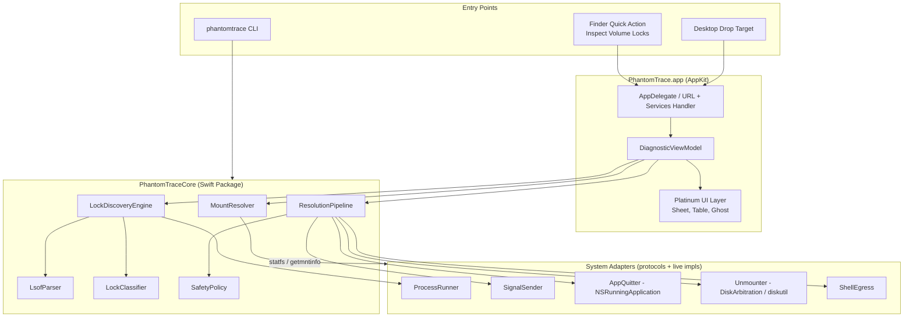
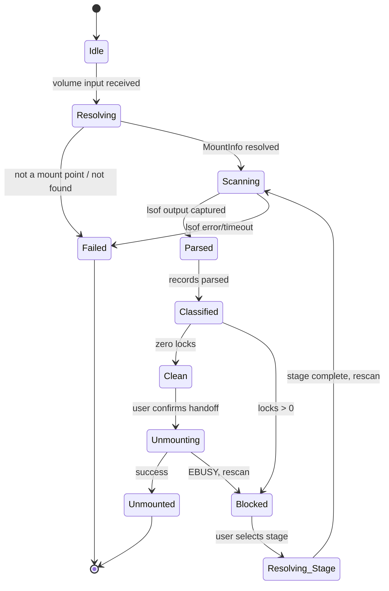
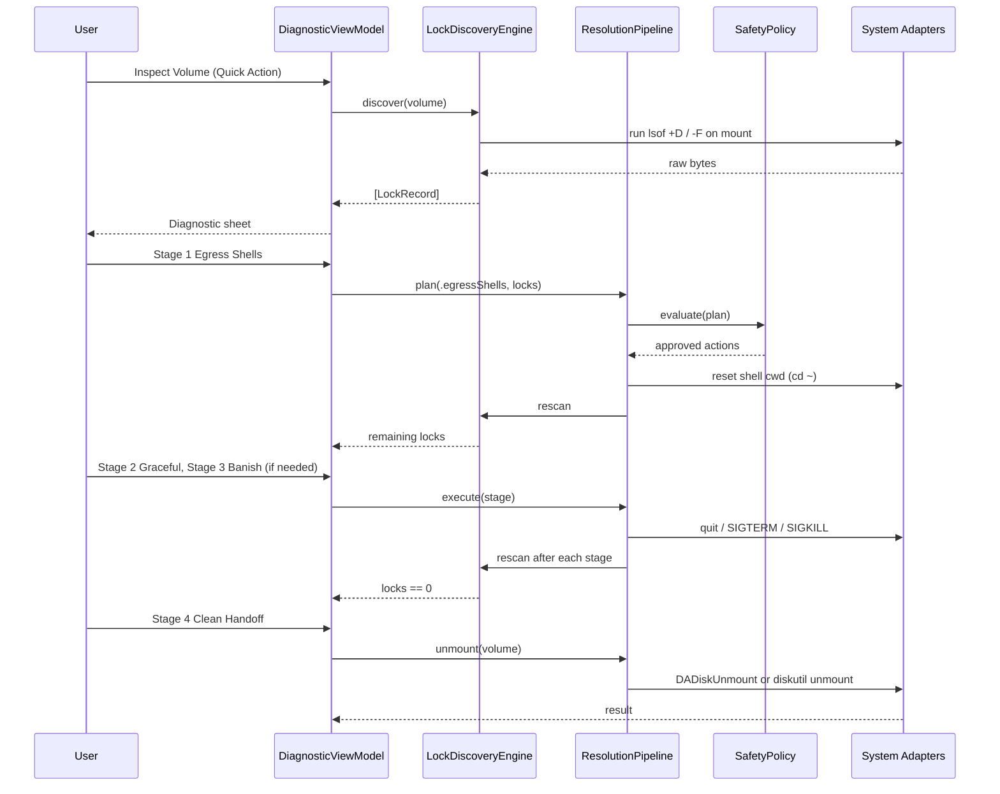

# Design Document: PhantomTrace — Volume Lock Forensics & Banishment

## Overview

PhantomTrace is a retro-themed macOS utility (targeting macOS 27.2.1 / build 26B131 or later) that answers the question Finder refuses to answer: "Which program is keeping this disk from ejecting?" Given a volume (external drive, USB stick, or mounted `.dmg`), it resolves the mount point, enumerates every process holding a lock on that volume, classifies each lock, and presents the result in a System 7 / Mac OS 9 Platinum-styled diagnostic sheet haunted by the Kiro ghost mascot. It resurrects classic "What's Keeping Me?" / Put Away inspector tools for modern Darwin and APFS (Hackathon category: Resurrection).

Locks are classified into three kinds: background system daemons (Spotlight `mds`, `mdworker_shared`, QuickLook satellites), CWD locks (idle shells such as `zsh`/`bash`/`node` whose current working directory sits inside the volume), and open file handles (apps with read/write descriptors on specific files). The user then walks a graduated resolution pipeline: (1) Egress Shells, (2) Graceful Request, (3) Banish Locks (targeted SIGKILL), (4) Clean Handoff (unmount via DiskArbitration or `diskutil`). Each stage is opt-in, previewed, and re-verified against fresh process discovery before the next, escalating only what is still blocking.

The system is implemented in Swift (Swift Package Manager core library + AppKit app target + Finder Quick Action). The core is pure and testable: parsers and classifiers are pure functions fuzzed with property-based tests; all system effects (spawning `lsof`, sending signals, unmounting) are behind protocols so they can be mocked. The project is developed spec-first with Kiro (`.kiro/specs`, steering, and hooks).

## Architecture



Layering rules: `PhantomTraceCore` imports only Foundation (and Darwin/DiskArbitration inside live adapters). It never imports AppKit. The UI depends on Core; Core never depends on UI.

### Discovery State Machine



### Resolution Pipeline Sequence



## Components and Interfaces

### Component 1: MountResolver

**Purpose**: Turn arbitrary user input (Finder-selected URL, dropped file, path inside a volume, `.dmg`) into a canonical `MountInfo`.

**Interface**:
```swift
public protocol MountResolving {
    func resolve(_ input: URL) throws -> MountInfo
    func allMounts() throws -> [MountInfo]
}
```

**Responsibilities**:
- Canonicalize via `realpath` / `resolvingSymlinksInPath` (handles `/Volumes/X` symlinks and firmlinks such as `/System/Volumes/Data`)
- Use `getmntinfo`/`statfs` to find the owning mount (longest-prefix match on `f_mntonname`)
- Map a mounted `.dmg` file to its attached volume (via `hdiutil info -plist` or DiskArbitration description)
- Refuse the root volume and system volumes (`/`, `/System/Volumes/*`, `/private/var/vm`)

### Component 2: LockDiscoveryEngine

**Purpose**: Produce the authoritative, current list of `LockRecord`s for a volume.

**Interface**:
```swift
public protocol LockDiscovering {
    func discover(on volume: MountInfo) async throws -> [LockRecord]
}
```

**Responsibilities**:
- Run `/usr/sbin/lsof -F pcLnftau0 -w +f -- <mountpoint>` through `ProcessRunner` with a timeout (machine-readable NUL-terminated field output)
- Fall back to `lsof +D` and `fuser -c` cross-check when output is truncated or `lsof` times out
- Hand bytes to `LsofParser`, then to `LockClassifier`
- Merge duplicate (pid, path) rows; drop PhantomTrace's own PID

### Component 3: LsofParser

**Purpose**: Pure, total parser of `lsof -F` output into `RawLsofRecord`s. Never throws on malformed input; surfaces warnings instead.

**Interface**:
```swift
public enum LsofParser {
    public static func parse(_ data: Data) -> ParseResult
}

public struct ParseResult: Equatable {
    public var records: [RawLsofRecord]
    public var warnings: [ParseWarning]
}
```

**Responsibilities**:
- Operate on raw bytes (not `String`) so non-UTF8 paths survive
- Decode `lsof` octal/hex escapes (`\x20`, `\\`) in names
- Handle paths with spaces, newlines, symlinks, trailing ` (deleted)`-style annotations, and truncated tail records
- Be deterministic and idempotent; ignore unknown field letters

### Component 4: LockClassifier

**Purpose**: Assign each `RawLsofRecord` a `LockCategory` and `ProcessRole`.

**Interface**:
```swift
public protocol LockClassifying {
    func classify(_ raw: RawLsofRecord, volume: MountInfo) -> LockRecord?
}
```

**Responsibilities**:
- `fd == "cwd"` → `.cwd`; numeric/`txt`/`mem` fds → `.openFileHandle`
- Command/path allowlist for `.systemDaemon` (`mds`, `mds_stores`, `mdworker_shared`, `QuickLookSatellite`, `fseventsd`, `corespotlightd`, `diskimages-helper`)
- Shell detection (`zsh`, `bash`, `fish`, `sh`, `dash`, `tcsh`) for egress eligibility; idle if foreground process group of its TTY is the shell itself
- Confirm path is actually under the volume mount (symlink-aware)

### Component 5: ResolutionPipeline

**Purpose**: Execute graduated, previewable, re-verified resolution stages.

**Interface**:
```swift
public protocol ResolutionPipelining {
    func plan(_ stage: ResolutionStage, locks: [LockRecord]) -> ResolutionPlan
    func execute(_ plan: ResolutionPlan, on volume: MountInfo) async -> StageOutcome
}
```

**Responsibilities**:
- Stage 1 Egress Shells: reset an idle shell's cwd without killing it
- Stage 2 Graceful Request: `NSRunningApplication.terminate()` for GUI apps, `SIGTERM` for CLI processes, then wait with grace timeout
- Stage 3 Banish Locks: `SIGKILL` only for hung daemons and orphan workers that survive stage 2 and pass `SafetyPolicy`
- Stage 4 Clean Handoff: unmount only when lock count is zero (re-verified immediately before)
- Rescan after every stage; never carry stale state forward

### Component 6: SafetyPolicy

**Purpose**: Central gate that decides which actions are allowed.

**Interface**:
```swift
public protocol SafetyPolicying {
    func evaluate(_ action: ProposedAction, context: SafetyContext) -> SafetyVerdict
}
```

**Responsibilities**:
- Deny PID 0/1, `launchd`, `kernel_task`, `WindowServer`, `loginwindow`, `Finder`, PhantomTrace itself, and processes owned by other users unless authorized
- Deny SIGKILL unless process is a known-safe category or user has explicitly confirmed per-process
- Enforce stage ordering (cannot Banish before Graceful has been attempted on that PID)
- Guard against PID reuse by verifying (pid, start time) identity immediately before signalling

### Component 7: Unmounter

**Purpose**: Perform the final unmount.

**Interface**:
```swift
public protocol Unmounting {
    func unmount(_ volume: MountInfo, force: Bool) async throws
}
```

**Responsibilities**:
- Primary: `DADiskCreateFromVolumePath` + `DADiskUnmount` with `kDADiskUnmountOptionDefault`
- Fallback: `/usr/sbin/diskutil unmount <mountpoint>` (argument array, no shell)
- Map `kDAReturnBusy`/`EBUSY` back to `Blocked` state; optional `eject` for the whole disk afterward
- Never use force unmount unless the user explicitly requests it in an advanced confirmation

### Component 8: Entry Points

**Purpose**: Get the user into the diagnostic sheet from Finder without a menu-bar widget.

**Responsibilities**:
- Finder Quick Action: Automator-style `.workflow` (or App Intent / Services `NSServices` entry) named "Why Can't I Eject?" / "Inspect Volume Locks" that passes the selected item to `phantomtrace://inspect?path=<percent-encoded>`
- Desktop drop target: a small, non-menu-bar window/Dock icon accepting dropped volume icons or folders
- `phantomtrace` CLI for scripting and for end-to-end tests

### Component 9: Platinum UI Layer

**Purpose**: Render the diagnostic sheet in System 7 / Mac OS 9 Platinum Retro Gothic style.

**Responsibilities**:
- Custom-drawn window chrome: pinstripe title bar, 1px beveled frames, platinum gray (#DDDDDD) background, square close/zoom boxes
- Typography: Chicago-like (e.g., bundled ChicagoFLF/open substitute) for titles, Monaco for table cells
- Table columns: Process Name, PID, User, Lock Category, File Path (with middle truncation and tooltip for full path)
- Buttons for each pipeline stage (disabled when not applicable), with progress states
- Kiro ghost mascot: glowing sprite that changes state (idle, haunting when locks found, banished/relieved when zero)
- Accessibility: VoiceOver labels on all custom controls, Reduce Motion respected for glow animation, sufficient contrast

## Data Models

### MountInfo

```swift
public struct MountInfo: Equatable, Hashable, Sendable {
    public let mountPoint: URL        // canonical, e.g. /Volumes/BACKUP
    public let volumeName: String     // display name
    public let deviceNode: String     // e.g. /dev/disk4s1
    public let fileSystemType: String // apfs, hfs, exfat, msdos, ...
    public let isInternal: Bool
    public let isRemovable: Bool
    public let isDiskImage: Bool
}
```

**Validation Rules**:
- `mountPoint` is absolute, canonical, and exists in the current mount table
- `mountPoint` is not `/` and not under `/System/Volumes`
- `volumeName` non-empty (falls back to last path component)

### RawLsofRecord

```swift
public struct RawLsofRecord: Equatable, Sendable {
    public var pid: Int32
    public var command: String           // lossy UTF-8 for display
    public var commandBytes: Data
    public var user: String?             // login name or uid string
    public var fd: String                // "cwd", "txt", "3r", "12u", ...
    public var accessMode: AccessMode?   // r, w, u
    public var fileType: String?         // REG, DIR, ...
    public var pathBytes: Data           // raw, exact bytes
    public var path: String              // lossy display form
}
```

**Validation Rules**:
- `pid > 0`
- `pathBytes` non-empty for emitted records
- `path` is derived from `pathBytes` using lossy decoding with U+FFFD; `pathBytes` is the source of truth

### LockRecord

```swift
public enum LockCategory: String, Sendable { case cwd, openFileHandle }

public enum ProcessRole: String, Sendable {
    case systemDaemon, idleShell, userApplication, cliTool, unknown
}

public struct LockRecord: Identifiable, Equatable, Sendable {
    public let id: UUID
    public let pid: Int32
    public let processName: String
    public let user: String
    public let category: LockCategory
    public let role: ProcessRole
    public let path: String
    public let pathBytes: Data
    public let accessMode: AccessMode?
    public let processStart: Date?   // identity guard against PID reuse
}
```

### ResolutionStage / Plan / Outcome

```swift
public enum ResolutionStage: Int, Comparable, Sendable {
    case egressShells = 1, gracefulRequest, banishLocks, cleanHandoff
}

public enum ProposedActionKind: Sendable {
    case resetShellCwd, quitApplication, sendSIGTERM, sendSIGKILL, unmount
}

public struct ProposedAction: Equatable, Sendable {
    public let kind: ProposedActionKind
    public let target: ProcessIdentity?   // (pid, startTime)
    public let reason: String
}

public struct ResolutionPlan: Equatable, Sendable {
    public let stage: ResolutionStage
    public let actions: [ProposedAction]
    public let skipped: [(LockRecord, SafetyDenial)]
}

public struct StageOutcome: Sendable {
    public let stage: ResolutionStage
    public let succeeded: [ProposedAction]
    public let failed: [(ProposedAction, Error)]
    public let remainingLocks: [LockRecord]
}
```

### Error Model

```swift
public enum PhantomTraceError: Error, Equatable {
    case notAMountPoint(URL)
    case protectedVolume(URL)
    case lsofUnavailable
    case lsofTimedOut(seconds: Double)
    case permissionDenied(pid: Int32)
    case processIdentityChanged(pid: Int32)
    case unmountBusy
    case unmountFailed(code: Int32)
}
```

## Algorithmic Pseudocode (Swift)

### Key Functions with Formal Specifications

### Function 1: MountResolver.resolve(_:)

```swift
func resolve(_ input: URL) throws -> MountInfo
```

**Preconditions:**
- `input` is a file URL
- `input` refers to an existing path or a `.dmg` file

**Postconditions:**
- Returns `MountInfo` whose `mountPoint` is a path-prefix of `realpath(input)` (or the attached volume of a `.dmg`)
- The returned mount is the longest-prefix match among all current mounts
- Throws `protectedVolume` if the mount is `/` or a system volume; no mutation of system state

**Loop Invariants:** During longest-prefix search, `best` is the longest matching mount seen so far.

### Function 2: LsofParser.parse(_:)

```swift
static func parse(_ data: Data) -> ParseResult
```

**Preconditions:**
- `data` is any byte sequence (including empty, truncated, or non-UTF8)

**Postconditions:**
- Never traps or throws
- Every emitted record has `pid > 0` and non-empty `pathBytes`
- `parse(data)` is deterministic
- For well-formed input produced by `lsof -F pcLnftau0`, round-tripping a generated record set through a serializer then `parse` yields the original records
- Malformed fragments produce a `ParseWarning`, not a partial/garbage record

**Loop Invariants:**
- `cursor` is monotonically non-decreasing and ≤ `data.count`
- `currentProcess` is either nil or a fully valid process-set header

### Function 3: LockClassifier.classify(_:volume:)

```swift
func classify(_ raw: RawLsofRecord, volume: MountInfo) -> LockRecord?
```

**Preconditions:**
- `raw` came from `LsofParser`
- `volume` is a valid `MountInfo`

**Postconditions:**
- Returns `nil` iff `raw.pathBytes` does not resolve under `volume.mountPoint`
- `fd == "cwd"` ⟺ `category == .cwd`
- `role == .systemDaemon` only when command is in the daemon allowlist
- Pure: no I/O besides optional symlink resolution through an injected `FileSystemProbe`

### Function 4: SafetyPolicy.evaluate(_:context:)

```swift
func evaluate(_ action: ProposedAction, context: SafetyContext) -> SafetyVerdict
```

**Preconditions:**
- `context` carries current user uid, own PID, protected process list, and stage history

**Postconditions:**
- Returns `.deny` for any action targeting a protected PID or name regardless of stage
- Returns `.deny` for `sendSIGKILL` if no prior `sendSIGTERM`/`quitApplication` was attempted on that identity (unless role is `.systemDaemon` hung by user confirmation)
- Returns `.allow` only for processes owned by the current user (or when elevated authorization exists)

### Main Algorithms

#### Mount resolution

```pascal
ALGORITHM resolveMount(input)
INPUT: input URL
OUTPUT: MountInfo or error

BEGIN
  canonical ← realpath(input)
  IF canonical IS NULL THEN THROW notAMountPoint(input)

  IF canonical ENDS WITH ".dmg" THEN
    attached ← hdiutilAttachedVolumes()
    FOR each vol IN attached DO
      IF vol.imagePath EQUALS canonical THEN RETURN toMountInfo(vol)
    END FOR
    THROW notAMountPoint(input)
  END IF

  best ← NULL
  FOR each m IN getmntinfo() DO
    ASSERT best IS NULL OR length(best.mountPoint) >= 0
    IF isPathPrefix(m.mountPoint, canonical) THEN
      IF best IS NULL OR length(m.mountPoint) > length(best.mountPoint) THEN
        best ← m
      END IF
    END IF
  END FOR

  IF best IS NULL THEN THROW notAMountPoint(input)
  IF isProtected(best) THEN THROW protectedVolume(best.mountPoint)
  RETURN best
END
```

#### Lsof field parsing (state machine)

```pascal
ALGORITHM parseLsofF(data)
INPUT: data bytes
OUTPUT: ParseResult

BEGIN
  records ← []; warnings ← []
  proc ← NULL; file ← NULL
  cursor ← 0

  WHILE cursor < length(data) DO
    ASSERT proc IS NULL OR proc.pid > 0
    (tag, value, next) ← readField(data, cursor)
    // field = 1 tag byte, value bytes until NUL or LF; next > cursor guaranteed
    IF tag IS NULL THEN
      warnings.add(truncatedTail(cursor)); BREAK
    END IF
    cursor ← next

    CASE tag OF
      'p': flush(file, proc, records); file ← NULL
           pid ← parseInt(value)
           IF pid IS INVALID OR pid <= 0 THEN
             warnings.add(badPid(value)); proc ← NULL
           ELSE proc ← newProc(pid)
           END IF
      'c': IF proc ≠ NULL THEN proc.commandBytes ← unescape(value)
      'L': IF proc ≠ NULL THEN proc.user ← lossy(value)
      'u': IF proc ≠ NULL AND proc.user IS NULL THEN proc.user ← "uid:" + value
      'f': flush(file, proc, records)
           file ← newFile(fd = lossy(value))
      'a': IF file ≠ NULL THEN file.access ← parseAccess(value)
      't': IF file ≠ NULL THEN file.type ← lossy(value)
      'n': IF file ≠ NULL THEN file.pathBytes ← unescape(value)
      OTHERWISE: // unknown tag ignored
    END CASE
  END WHILE

  flush(file, proc, records)
  RETURN ParseResult(records, warnings)
END
```

**Preconditions:**
- `readField` always advances cursor by at least 1 byte

**Postconditions:**
- Each record is emitted at most once; `flush` emits only when `proc ≠ NULL` and `file.pathBytes` non-empty
- Terminates in O(n)

**Loop Invariants:**
- `cursor` strictly increases each iteration
- `file ≠ NULL` implies `proc ≠ NULL` at emission time

#### Staged resolution

```pascal
ALGORITHM runStage(stage, volume)
INPUT: stage, volume
OUTPUT: StageOutcome

BEGIN
  locks ← discover(volume)                       // fresh scan, never cached
  plan ← buildPlan(stage, locks)
  succeeded ← []; failed ← []

  FOR each action IN plan.actions DO
    ASSERT action.stage = stage
    verdict ← SafetyPolicy.evaluate(action, context)
    IF verdict = deny THEN CONTINUE
    IF action.target ≠ NULL AND NOT identityMatches(action.target) THEN
      failed.add(action, processIdentityChanged); CONTINUE
    END IF
    result ← perform(action)
    IF result IS success THEN succeeded.add(action) ELSE failed.add(action, result.error)
  END FOR

  WAIT gracePeriod(stage)
  remaining ← discover(volume)
  RETURN StageOutcome(stage, succeeded, failed, remaining)
END
```

**Loop Invariants:**
- Every performed action previously received `allow` from SafetyPolicy
- Each action targets a process whose identity was re-verified immediately prior

#### Plan building per stage

```pascal
ALGORITHM buildPlan(stage, locks)
BEGIN
  actions ← []
  CASE stage OF
    egressShells:
      FOR each l IN locks WHERE l.category = cwd AND l.role = idleShell DO
        actions.add(resetShellCwd(l.pid))
      END FOR
    gracefulRequest:
      FOR each pid IN distinctPids(locks) WHERE role ≠ systemDaemon-protected DO
        IF isGuiApp(pid) THEN actions.add(quitApplication(pid))
        ELSE actions.add(sendSIGTERM(pid))
      END FOR
    banishLocks:
      FOR each pid IN distinctPids(locks) WHERE survivedGraceful(pid) DO
        actions.add(sendSIGKILL(pid))
      END FOR
    cleanHandoff:
      IF locks IS EMPTY THEN actions.add(unmount(volume))
  END CASE
  RETURN ResolutionPlan(stage, actions)
END
```

#### Shell cwd egress

Resetting another process's cwd cannot be done by a syscall. The approach, in order of preference:

```pascal
ALGORITHM egressShell(pid)
INPUT: shell pid with cwd inside volume
OUTPUT: success or failure

BEGIN
  tty ← ttyOf(pid)
  IF tty IS NULL OR shellIsRunningForegroundJob(pid) THEN RETURN failure(notIdle)
  // Preferred: inject "cd ~" via the terminal the shell is attached to
  IF terminalIsScriptable(tty) THEN      // Terminal.app / iTerm2 AppleScript, per-tab "write text"
    sendTextToTab(tty, " cd ~")           // leading space avoids history
    RETURN verifyCwdLeftVolume(pid)
  END IF
  RETURN failure(requiresManualAction)    // fall through to Graceful stage (SIGHUP/SIGTERM)
END
```

Rationale: macOS has no ptrace-free cwd change; TIOCSTI is restricted. Scriptable terminals are the safe route; otherwise the stage reports "manual" and the user may escalate.

## Example Usage

```swift
// Inspect a volume end-to-end
let resolver = LiveMountResolver()
let volume = try resolver.resolve(URL(fileURLWithPath: "/Volumes/BACKUP/photos"))

let engine = LockDiscoveryEngine(runner: LiveProcessRunner(),
                                 classifier: DefaultLockClassifier())
var locks = try await engine.discover(on: volume)

// Parser used directly (also the fuzzing target)
let result = LsofParser.parse(Data("p123\0cmdname\0Lalice\0fcwd\0n/Volumes/My Disk/dir\0".utf8))

// Walk the pipeline
let pipeline = ResolutionPipeline(safety: DefaultSafetyPolicy(), adapters: .live, discovery: engine)
for stage in [ResolutionStage.egressShells, .gracefulRequest] where !locks.isEmpty {
    let plan = pipeline.plan(stage, locks: locks)
    let outcome = await pipeline.execute(plan, on: volume)
    locks = outcome.remainingLocks
}
if locks.isEmpty { try await LiveUnmounter().unmount(volume, force: false) }
```

## Project Layout

```
PhantomTrace/
├── README.md                     # Pitch, screenshots, install, usage, Kiro workflow notes
├── LICENSE                       # MIT
├── .gitignore
├── .swiftlint.yml
├── Package.swift                 # SwiftPM: PhantomTraceCore, phantomtrace CLI, tests
├── Sources/
│   ├── PhantomTraceCore/
│   │   ├── Mounts/               # MountInfo, MountResolver
│   │   ├── Discovery/            # LsofParser, LockDiscoveryEngine, LockClassifier
│   │   ├── Resolution/           # ResolutionPipeline, SafetyPolicy, ShellEgress
│   │   ├── System/               # ProcessRunner, SignalSender, Unmounter (live adapters)
│   │   └── Models/               # LockRecord, errors, stages
│   └── phantomtrace/             # CLI executable
├── Tests/
│   ├── PhantomTraceCoreTests/    # Unit tests with mock adapters
│   ├── PhantomTracePropertyTests/# SwiftCheck property tests (parser fuzzing)
│   └── Fixtures/                 # Captured lsof outputs (spaces, non-UTF8, symlinks)
├── App/
│   ├── PhantomTrace.xcodeproj    # AppKit app target depending on the local package
│   ├── PhantomTrace/             # AppDelegate, ViewModel, Platinum UI, Assets (ghost sprites, fonts)
│   ├── QuickAction/              # "Why Can't I Eject?".workflow / Services plist
│   └── Info.plist, PhantomTrace.entitlements
├── Scripts/
│   ├── install-quick-action.sh
│   └── lint-and-test.sh          # Used by hooks
├── docs/                         # Architecture notes, demo script, screenshots
└── .kiro/
    ├── specs/
    │   └── phantomtrace-volume-lock-forensics/   # this spec (+ future focused specs)
    │       ├── .config.kiro
    │       ├── design.md
    │       ├── requirements.md
    │       └── tasks.md
    ├── steering/
    │   ├── product.md            # Mission, Resurrection theme, tone
    │   ├── tech.md               # Swift, SwiftPM, AppKit, DiskArbitration, no third-party runtime deps
    │   ├── structure.md          # Layering rules, directory conventions
    │   └── safety.md             # Never SIGKILL protected processes; no shell string interpolation
    └── hooks/
        ├── swiftlint-pre-commit.json   # PreToolUse on git commit: run swiftlint --strict
        ├── tests-pre-commit.json       # PreToolUse on git commit: swift test must pass
        └── lint-on-save.json           # PostFileSave on *.swift
```

**Planned focused specs** (as the user requested spec-driven development): `mount-point-path-resolution`, `darwin-process-discovery-state-machine`, `safe-unmount-workflow`.

**Dependencies in layout**: SwiftCheck (test-only) for property tests; SwiftLint as a developer tool (not a package dependency).

## Correctness Properties

*A property is a characteristic or behavior that should hold true across all valid executions of a system-essentially, a formal statement about what the system should do. Properties serve as the bridge between human-readable specifications and machine-verifiable correctness guarantees.*

### Property 1: Parser totality

For any byte sequence `data` (including empty, truncated, or non-UTF8), `LsofParser.parse(data)` returns without crashing and terminates.

**Validates: Requirements 4.1**

### Property 2: Parser round-trip

For any set `R` of valid records (including paths with spaces, newlines, unicode, backslashes, and arbitrary non-UTF8 bytes), `parse(print(R)).records == R`, and parsing then printing then parsing yields an equivalent record set.

**Validates: Requirements 4.4, 4.9, 4.11, 4.12**

### Property 3: Byte fidelity

For any emitted record, `pathBytes` equals the unescaped bytes from the input, and deriving the lossy display path never mutates `pathBytes`.

**Validates: Requirements 4.2, 4.3**

### Property 4: Record validity and determinism

For any input `data`, every record in `parse(data).records` has `pid > 0` and non-empty `pathBytes`, and parsing `data` repeatedly returns identical results.

**Validates: Requirements 4.5, 4.10**

### Property 5: Truncation safety

For any `data` and any prefix `p` of `data`, no record in `parse(p)` is absent from `parse(data)`; a final incomplete record becomes a warning.

**Validates: Requirements 4.7, 4.13**

### Property 6: Unknown-field tolerance

For any valid input, inserting fields with unknown tags never changes the emitted records.

**Validates: Requirements 4.8**

### Property 7: Classification consistency

For any raw record and volume, the category is `.cwd` if and only if `fd == "cwd"`; the classifier returns a record if and only if the path resolves under the volume mount point; and the role is `.systemDaemon` for every command in the daemon allowlist.

**Validates: Requirements 5.1, 5.2, 5.3, 5.6, 5.8**

### Property 8: Symlink containment

For any symlink pointing out of the volume, a path under the symlink location is not reported unless its target is on the volume.

**Validates: Requirements 5.7**

### Property 9: Mount resolution

For any path `p` under mount table `M`, `resolve(p).mountPoint` is the longest mount prefix of `realpath(p)`, and the returned `MountInfo` is absolute, canonical, and has a non-empty volume name.

**Validates: Requirements 1.1, 1.2, 1.3, 1.9**

### Property 10: Protected volume refusal

For any path whose owning mount is `/`, under `/System/Volumes`, or `/private/var/vm`, resolution fails with `protectedVolume`.

**Validates: Requirements 2.1**

### Property 11: Safety deny-list

For any action targeting PID 0, PID 1, own PID, `launchd`, `kernel_task`, `WindowServer`, `loginwindow`, or `Finder`, in any stage, `SafetyPolicy.evaluate == .deny`; for any process owned by another user without authorization the result is also `.deny`; and an action on a current-user, non-protected process that satisfies stage ordering is `.allow`.

**Validates: Requirements 6.1, 6.2, 6.5**

### Property 12: Escalation order

For any process identity, `sendSIGKILL` is approved only after a recorded graceful attempt on the same identity (or explicit per-process confirmation of a system daemon), and a graceful attempt is recorded whenever `quitApplication` or `sendSIGTERM` is performed.

**Validates: Requirements 6.3, 6.4, 8.6, 9.1**

### Property 13: Identity guard

For any signal sent, the target's (pid, start time) matched the discovered identity at send time; on mismatch the action is skipped with `processIdentityChanged`.

**Validates: Requirements 6.8, 6.9**

### Property 14: Stage plan construction

For any set of locks, the Egress plan contains exactly one `resetShellCwd` per cwd lock held by an idle shell; the Graceful plan contains `quitApplication` for each distinct GUI pid and `sendSIGTERM` for each distinct non-GUI, non-protected pid; and actions denied by the safety policy appear as skipped, never as executed.

**Validates: Requirements 7.1, 8.1, 8.2, 8.3, 11.7**

### Property 15: Unmount gating

For any mocked system state, `unmount` is attempted only when a fresh scan immediately before reports zero locks; otherwise no unmount is attempted and the machine returns to `Blocked`.

**Validates: Requirements 10.1, 10.2, 10.3**

### Property 16: Fresh state per stage

For any stage execution, the plan is built from a fresh scan and the outcome's remaining locks come from a rescan after the stage completes.

**Validates: Requirements 11.1, 11.2**

### Property 17: Discovery idempotence and merging

With an unchanged mocked system, repeated `discover` calls return equal results, and the result contains at most one lock per (pid, path) and none for PhantomTrace's own PID.

**Validates: Requirements 3.3, 3.4, 3.5**

### Property 18: Quick Action URL round-trip

For any file path, percent-encoding it into a `phantomtrace://inspect?path=` URL and decoding then canonicalizing it yields the canonical original path.

**Validates: Requirements 12.1, 12.3**

### Property 19: Middle truncation

For any path and column width, the truncated display string fits the width, keeps the path's first and last components' leading and trailing characters, and equals the path when it already fits.

**Validates: Requirements 13.2**

### Property 20: Ghost state mapping

For any discovery state, the ghost sprite is idle for idle/scanning, haunting for Blocked, and banished for clean/unmounted.

**Validates: Requirements 13.6, 13.7, 13.8**

### Property 21: Argument-array fidelity

For any path (including spaces, quotes, and shell metacharacters), the subprocess argument passed to the process runner equals the path verbatim as a single argument.

**Validates: Requirements 15.1**

## Error Handling

### Error Scenario 1: Input is not on a mountable volume

**Condition**: Dropped/selected item resolves to `/` or a system volume, or is not under any mount.
**Response**: Show a Platinum alert ("This isn't a removable volume") with the ghost in a neutral state; no scan is performed.
**Recovery**: User picks another volume.

### Error Scenario 2: lsof unavailable, times out, or truncated

**Condition**: `lsof` missing, exceeds timeout (default 15 s for large volumes), or outputs a truncated tail.
**Response**: Surface a partial-results banner; fall back to `fuser -c`/`lsof +D` cross-check; list parser warnings.
**Recovery**: "Rescan" button; recommend narrowing scope.

### Error Scenario 3: Permission denied for other-user processes

**Condition**: Process owned by root or another user; signals return `EPERM`; lsof may hide them.
**Response**: Show those locks as read-only with a lock icon and explanation; never attempt silent privilege escalation.
**Recovery**: Offer an explicit, user-initiated authorization (`AuthorizationServices`) or manual instructions.

### Error Scenario 4: Process identity changed (PID reuse)

**Condition**: Start time differs from discovery snapshot.
**Response**: Skip the action, log it, mark as failed with `processIdentityChanged`.
**Recovery**: Automatic rescan before the next attempt.

### Error Scenario 5: Unmount returns busy

**Condition**: `kDAReturnBusy`/`EBUSY` at handoff, new lock arrived between scan and unmount.
**Response**: Return to Blocked, rescan, display newly found culprits.
**Recovery**: Restart pipeline at the appropriate stage; force unmount only under advanced confirmation.

### Error Scenario 6: Shell egress not possible

**Condition**: Shell's terminal is not scriptable or shell is running a foreground job.
**Response**: Mark action as "manual" with exact instruction ("run `cd ~` in the terminal for PID n").
**Recovery**: User action or escalation to Graceful stage.

## Testing Strategy

### Unit Testing Approach

- Swift Testing / XCTest in `PhantomTraceCoreTests` with mock `ProcessRunner`, `SignalSender`, `Unmounter`, `FileSystemProbe`.
- Fixture-driven parser tests from real captured `lsof` outputs: spaces, newlines, unicode, `\x` escapes, deleted files, symlinked mounts, `/Volumes` firmlink.
- Classifier tests for each daemon allowlist entry and shell variant.
- Safety policy table tests for every protected process and stage-order rule.
- Pipeline tests with scripted mock systems verifying rescan-after-stage and unmount gating.
- Coverage goal: ≥ 90% on `PhantomTraceCore`.

### Property-Based Testing Approach

Fuzz the `lsof`/`fuser` output parser against malformed paths, non-UTF8 bytes, spaces, symlinks, truncation, and interleaved unknown fields. Cover Correctness Properties 1–8 and 14 using generators for: arbitrary `Data`; structured record sets serialized to `lsof -F` format; byte-level mutations (flip, drop, duplicate, truncate) of valid output. Safety-policy properties (10–12) use generated process tables and stage histories.

**Property Test Library**: SwiftCheck (default 500+ iterations in CI, shrinking enabled; minimized counterexamples saved as fixtures).

### Integration Testing Approach

- Local-only test creating a temporary disk image (`hdiutil create -size 10m -fs APFS`), attaching it, spawning helper processes (`cat` on a file, a shell with cwd inside), then running discover → pipeline → unmount end-to-end via the CLI.
- UI snapshot tests of the diagnostic sheet in idle/haunted/clean states.
- Manual QA checklist for the Finder Quick Action and drop target.

## Performance Considerations

- `lsof` on large volumes is slow; prefer `lsof -F … -- <mountpoint>` (device-based, fast) over `+D` (directory recursion), with `+D` only as a fallback.
- Stream/process output incrementally; run discovery off the main actor and publish results via `AsyncStream`.
- Rescans after stages are debounced (e.g., 500 ms settle) and bounded by a timeout.
- Target: first results shown in under 2 s for typical external drives.

## Security Considerations

- All subprocesses launched via `Process` with argument arrays; no shell interpolation of paths. Paths from `lsof` are untrusted data and never executed.
- Signals only to verified identities and only to processes owned by the current user by default; no silent privilege elevation.
- SafetyPolicy is the single choke point; the UI cannot call signal adapters directly.
- No network access; no telemetry. Diagnostic data stays local.
- App Sandbox cannot be enabled (needs `lsof`/signals); document hardened runtime, notarization, and minimal entitlements. Quick Action handler validates the `phantomtrace://` URL input (percent-decoding, canonicalization) before use.
- AppleScript/terminal automation requires user-granted Automation permission; text injected is a fixed literal (` cd ~`), never derived from user data.

## Dependencies

- Apple frameworks: Foundation, AppKit, DiskArbitration, Darwin, OSLog
- System tools: `/usr/sbin/lsof`, `/usr/bin/fuser` (optional cross-check), `/usr/sbin/diskutil`, `/usr/bin/hdiutil`
- Test-only: SwiftCheck (SwiftPM), XCTest / Swift Testing
- Dev tooling: SwiftLint (Homebrew), Kiro hooks to enforce `swiftlint --strict` and `swift test` before commits
- Platform: macOS "Golden Gate" (27.2.1, build 26B131) or later, the only version available for testing; older macOS releases are unsupported. Swift toolchain matching that SDK
- Assets: bundled bitmap-style fonts (open-licensed Chicago/Monaco-alike substitutes verified for license) and Kiro ghost sprite set
- Repository deliverables: public GitHub repo, MIT `LICENSE`, clean commit history, visible `.kiro/` folder, demo video ≤ 3 minutes
