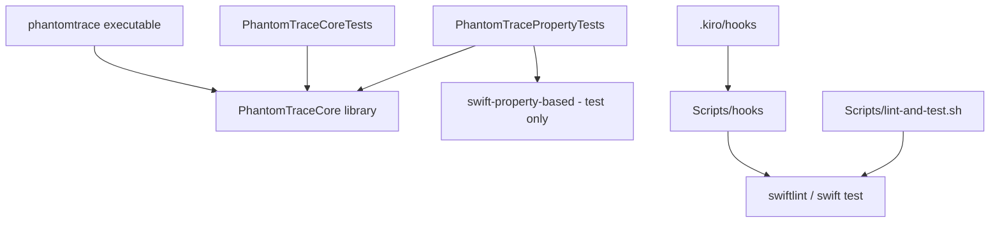

# Design Document: Project Scaffolding

## Overview

This feature creates the initial PhantomTrace repository foundation: folder structure, an empty but buildable SwiftPM package, README, LICENSE, `.gitignore`, SwiftLint config, documentation stubs, Kiro steering files, Kiro hooks, and a helper script. It contains no feature logic. The layout follows the "Project Layout" section of the Master_Spec (`.kiro/specs/phantomtrace-volume-lock-forensics/`), which is not modified.

The target platform is macOS only, and macOS 27.2.1 (build 26B131) only. Every other macOS version and operating system is out of scope. SwiftPM can only declare a minimum platform, so the exact-version scope is stated in prose in the README, `docs/ProjectOverview.md`, and the `product.md` and `tech.md` steering files.

The scaffold is also shaped by the Kiroween 2026 rules (`docs/Hackathon/Rules.md`). The rules and judging criteria drive these decisions:
- Eligibility: public GitHub repo, detectable MIT license, `/.kiro` present and never gitignored, runnable instructions, English-only materials, no copyrighted media or third-party trademarks.
- Technological Implementation (20%): visible, varied Kiro use. The scaffold therefore ships specs, six steering files, three hooks, and a `docs/KiroUsage.md` write-up skeleton.
- Presentation (20%): a demo script for a video under 3 minutes that shows the app running on the Mac.
- Impact, Design, Innovation (60%): the README and `docs/ProjectOverview.md` state the real problem, audience, category, and visual direction.

Key design decisions:
- The scaffold is static files only. There is no generator program; the files are written once by the spec task executor.
- The Package has one library, one executable, and two test targets. Only the property test target depends on swift-property-based.
- Empty directories are kept with zero-byte `.gitkeep` files, which are removed from a directory only when real content arrives (not part of this feature).
- Nothing touches git: no `git init`, no commit, no config changes.
- The `App/` directory, Xcode project, and Quick Action are deliberately absent; a later feature adds them.

## Architecture



Resulting repository tree (new items only):

```
PhantomTrace/
├── Package.swift
├── README.md
├── LICENSE
├── .gitignore
├── .swiftlint.yml
├── Sources/
│   ├── PhantomTraceCore/
│   │   ├── PhantomTraceCore.swift        # placeholder version constant
│   │   ├── Mounts/.gitkeep
│   │   ├── Discovery/.gitkeep
│   │   ├── Resolution/.gitkeep
│   │   ├── System/.gitkeep
│   │   └── Models/.gitkeep
│   └── phantomtrace/main.swift
├── Tests/
│   ├── PhantomTraceCoreTests/PlaceholderTests.swift
│   ├── PhantomTracePropertyTests/PlaceholderPropertyTests.swift
│   └── Fixtures/.gitkeep
├── Scripts/
│   ├── lint-and-test.sh                  # mode 755
│   ├── hooks/{commit-gate,lint-on-save}.sh  # mode 755
│   └── README.md
├── docs/
│   ├── ProjectOverview.md                # pitch, problem, category, platform
│   ├── SubmissionChecklist.md            # rules checklist and criteria map
│   ├── KiroUsage.md                      # Kiro feature write-up
│   ├── architecture.md
│   ├── demo-script.md
│   ├── Hackathon/{Rules,Faq}.md
│   └── screenshots/.gitkeep
└── .kiro/
    ├── steering/{product,tech,structure,safety,testing,hackathon}.md
    └── hooks/{lint-on-save,pre-commit-check,kiro-gitignore-guard}.json
```

Because `Sources/PhantomTraceCore` contains a source file, its directory-level `.gitkeep` is not needed; the five subdirectories contain only `.gitkeep` and so keep it (Requirement 1.3). `Sources/phantomtrace`, `Tests/PhantomTraceCoreTests`, and `Tests/PhantomTracePropertyTests` likewise contain source files.

## Components and Interfaces

### Package.swift

```swift
// swift-tools-version: 6.0
import PackageDescription

let package = Package(
    name: "PhantomTrace",
    platforms: [.macOS("27.2.1")],   // see note below
    products: [
        .library(name: "PhantomTraceCore", targets: ["PhantomTraceCore"]),
        .executable(name: "phantomtrace", targets: ["phantomtrace"])
    ],
    dependencies: [
        .package(url: "https://github.com/x-sheep/swift-property-based.git", exact: "2.0.1")
    ],
    targets: [
        .target(name: "PhantomTraceCore"),
        .executableTarget(name: "phantomtrace", dependencies: ["PhantomTraceCore"]),
        .testTarget(name: "PhantomTraceCoreTests", dependencies: ["PhantomTraceCore"]),
        .testTarget(name: "PhantomTracePropertyTests",
                    dependencies: ["PhantomTraceCore",
                                   .product(name: "PropertyBased", package: "swift-property-based")])
    ]
)
```

Platform declaration (Requirement 2.2): the implementer uses the `PackageDescription` `SupportedPlatform` form that expresses macOS 27.2.1, or, if the installed toolchain only provides named-version cases, the lowest case that is at least that release (for example `.v27`). The chosen value is checked with `swift build`. No earlier macOS is declared. swift-property-based is pinned to an exact version (the implementer confirms the latest release resolves under the installed toolchain).

### PhantomTraceCore

`Sources/PhantomTraceCore/PhantomTraceCore.swift`:

```swift
import Foundation

public enum PhantomTraceCore {
    public static let version = "0.0.0"
}
```

Imports only Foundation, one public declaration, version string length 5 (within 1 to 32).

### CLI

`Sources/phantomtrace/main.swift`:

```swift
import PhantomTraceCore

print(PhantomTraceCore.version)
```

`print` writes the string plus one newline to stdout, nothing to stderr, exit status 0. The version comes only from Core_Library.

### Placeholder tests

Each test target has one passing test (for example `XCTAssertEqual(PhantomTraceCore.version, "0.0.0")` in the core target and `XCTAssertTrue(true)` in the property target, which also imports swift-property-based so that dependency resolution is exercised).

### SwiftLint configuration

`.swiftlint.yml`:

```yaml
included:
  - Sources
  - Tests
```

All placeholder Swift files are written to pass `swiftlint --strict` with default rules (trailing newline, no trailing whitespace, lines under 120 characters).

### Hooks

Written in the Kiro v2 hook format (`version`, `hooks` array with one entry each). Each file has one trigger and one `command` action.

| File | Trigger | Matcher | Action |
|---|---|---|---|
| `lint-on-save.json` | `PostFileSave` | `.*\.swift$` | `Scripts/hooks/lint-on-save.sh`: reads the saved file path from stdin and runs `swiftlint lint --strict --path <file>` |
| `pre-commit-check.json` | `PreToolUse` | `execute_bash` | `Scripts/hooks/commit-gate.sh checks`: exits 0 unless the command is `git commit`; if `swiftlint` is missing prints "SwiftLint is unavailable" and exits 2; otherwise runs `Scripts/lint-and-test.sh` and exits 2 on failure |
| `kiro-gitignore-guard.json` | `PreToolUse` | `execute_bash` | `Scripts/hooks/commit-gate.sh gitignore`: exits 0 unless the command is `git commit`; if `.gitignore` matches `^/?\.kiro(/|$)` prints "Ignoring .kiro can disqualify the Kiroween submission" and exits 2 |

Why three hooks: the two commit-time checks share one script (`lint-and-test.sh`) instead of two near-identical hooks, the per-file lint gives the fastest feedback, and the gitignore guard costs one `grep` for a disqualification-level risk. A PostTaskExec test hook and a Stop hook were rejected as duplicate or noisy.

Limits: PreToolUse hooks only see commits the agent runs, not commits typed in a terminal. The hook stdin payload uses snake_case fields (`tool_name`, `tool_input`); `commit-gate.sh` reads `tool_input.command` and treats a missing command as "not a commit". The scripts are tested live and by piping sample payloads.

Exit code 2 blocks the action and forwards stderr to the user (per hook semantics). Hooks only read the working tree and never modify or stage anything, which satisfies the "leave working tree unmodified" criteria. The commands read the JSON from stdin to detect `git commit` and to obtain the saved file path, and quote all paths. The implementer verifies the exact stdin field names against the hook documentation when writing them.

### Scripts/lint-and-test.sh

```bash
#!/bin/bash
set -u
cd "$(dirname "$0")/.." || exit 1
swiftlint --strict || exit 1
swift test || exit 1
```

Runs lint first; a lint failure prints its output and exits non-zero without running tests; a test failure exits non-zero; success exits 0. File mode 755 (owner execute bit set). `Scripts/README.md` states that `install-quick-action.sh` is reserved for a later feature and is not present.

### Steering files

Six concise Markdown files in `.kiro/steering/`, derived from the Master_Spec and the Hackathon_Rules, each containing the statements required by Requirement 6:
- `product.md`: mission "identify which processes prevent a volume from ejecting", Resurrection theme, macOS only and macOS 27.2.1 (build 26B131) only, every other version out of scope.
- `hackathon.md`: category and deadline, `.kiro/` never gitignored, public GitHub repo with MIT license, demo video under 3 minutes with no copyrighted material, English-only materials, keep `docs/KiroUsage.md` current.
- `tech.md`: Swift, SwiftPM, AppKit, DiskArbitration; macOS 27.2.1 only; zero third-party runtime dependencies; swift-property-based and SwiftLint as test and development tools only.
- `structure.md`: Core_Library imports no AppKit; lists the nine directories and five Core subdirectories from Requirement 1.
- `safety.md`: argument-array subprocesses without a shell; Safety_Policy is the single approval path; protected processes never signalled; no network, no telemetry.
- `testing.md`: swift-property-based at least 500 iterations per property in CI; round-trip property for every parser and printer; every system effect behind a mock protocol.

### Documentation, README, LICENSE, .gitignore

- `README.md`: pitch, problem, three lock types, resolution pipeline, status section containing "scaffolding stage", platform statement (macOS only, macOS 27.2.1 (build 26B131) only; everything else unsupported), build section with `swift build` then `swift test` in separate fenced blocks, "Built with Kiro" section, hackathon section (category, no pre-existing code, no runtime dependencies, links to the Submission_Docs), relative links to `.kiro/specs/phantomtrace-volume-lock-forensics/` and `.kiro/specs/project-scaffolding/`, MIT statement with link to `LICENSE`. Run instructions are added when a runnable app exists.
- `docs/ProjectOverview.md`, `docs/SubmissionChecklist.md`, `docs/KiroUsage.md`: submission-facing documents described in Requirement 5. `KiroUsage.md` only records real usage and marks the rest "Evidence to add".
- `LICENSE`: standard MIT text, `Copyright (c) <YYYY> iolaire mcfadden` with the current four-digit year at creation time.
- `.gitignore`: one line each for `.build/`, `.swiftpm/`, `*.xcodeproj/xcuserdata/`, `DerivedData/`, `.DS_Store`.
- `docs/architecture.md`: first line `# Architecture`, with a relative link `../.kiro/specs/phantomtrace-volume-lock-forensics/design.md`.
- `docs/demo-script.md`: first line `# Demo Script`, with the sentence "The demo length target is at most 3 minutes (180 seconds)." and the planned flow: locked drive, Finder failing to eject, PhantomTrace revealing the process, safe eject. The video must show the app running on a Mac, use no copyrighted music or trademarks, and be public on YouTube.

## Data Models

There are no runtime data models. The only structured data are the hook JSON files:

```json
{
  "version": "v1",
  "hooks": [
    {
      "name": "<name>",
      "trigger": "<PreToolUse | PostFileSave>",
      "matcher": "<optional regex>",
      "action": { "type": "command", "command": "<shell command>" }
    }
  ]
}
```

## Error Handling

- Existing directories (Requirement 1.6): creation uses create-if-absent semantics (`mkdir -p`); existing contents are never deleted or overwritten, and no error is reported.
- Existing files: the implementer reads a file before overwriting it and does not replace files that already hold user content without confirmation.
- Dependency resolution failure (Requirement 2.10): SwiftPM already exits non-zero and names the unresolved package; source files are not modified by that failure.
- Missing SwiftLint (Requirement 7.7): the pre-commit hook blocks the commit with an "SwiftLint is unavailable" message. The `lint-and-test.sh` script likewise fails because `swiftlint` is not found.
- Validation failures (Requirements 3.5, 5.5, 6.7): the validation script reports the file and failed check; it makes no changes.
- Git policy (Requirement 8.6, 8.7): the task list contains no git commands. After scaffolding, `.git` exists only if it existed before.

## Testing Strategy

Property-based testing does not apply to this feature. It consists of static files, configuration, and declarative package structure with no function that has meaningful input variation, so the Correctness Properties section is omitted. The placeholder `PhantomTracePropertyTests` target exists only so later features have swift-property-based wired up.

Verification is by smoke checks and example-based checks, collected in one shell script that the final task runs (for example `Scripts/verify-scaffold.sh`, or run ad hoc and not committed; the choice is left to the task list). Checks:

- Structure (R1): every required directory exists; each directory containing only scaffold subdirectories or nothing holds a zero-byte `.gitkeep`; no `App`, `.xcodeproj`, `.xcworkspace`, `.workflow`, or `.action` items exist; master spec files are unchanged (compare a checksum listing taken before and after).
- Package (R2): `swift build` and `swift test` exit 0; running `swift run phantomtrace` prints exactly `0.0.0\n` on stdout with empty stderr; `Package.swift` inspected for a single library, single executable, swift-property-based only on the property test target; Core source imports only Foundation.
- Documents (R3, R5): README contains required phrases and the commands in order; a link checker resolves every relative link in `README.md` and `docs/*.md`; first-line headings and the 180-second sentence are present; `docs/screenshots/.gitkeep` is 0 bytes.
- Licensing and lint (R4): LICENSE copyright line matches a regex `^Copyright \(c\) [0-9]{4} iolaire mcfadden$`; each `.gitignore` entry is on its own line; `swiftlint --strict` exits 0.
- Steering (R6): each file exists, is non-empty UTF-8, and contains grep-able required phrases.
- Hooks (R7): each file parses as JSON (`python3 -m json.tool`), has exactly one trigger and one action; manual spot checks run the hook commands: one with a deliberately failing lint, one with `swiftlint` removed from `PATH`, and one with a temporary `.kiro/` line in a copy of `.gitignore` for the guard hook.
- Hackathon readiness (R9): `.kiro/specs`, `.kiro/steering`, and `.kiro/hooks` exist; `.gitignore` has no `.kiro` entry; `LICENSE` is the standard MIT text; the three Submission_Docs and `hackathon.md` exist and are non-empty; no non-English or binary media assets are present. The script cannot verify repository visibility, license detection on GitHub, the YouTube video, or the form fields, so those stay manual items in `docs/SubmissionChecklist.md`.
- Script (R8): the owner execute bit is set; behaviour tested by running it on the clean tree (exit 0) and with a temporary lint violation (exit non-zero, tests not run); the temporary violation is removed afterward.
- Git (R8): `.git` presence before and after scaffolding is identical.
