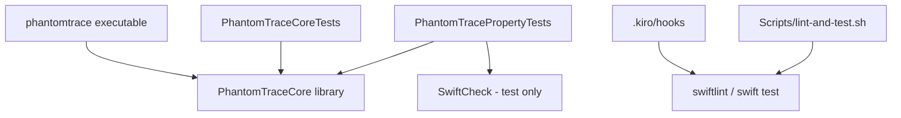

# Design Document: Project Scaffolding

## Overview

This feature creates the initial PhantomTrace repository foundation: folder structure, an empty but buildable SwiftPM package, README, LICENSE, `.gitignore`, SwiftLint config, documentation stubs, Kiro steering files, Kiro hooks, and a helper script. It contains no feature logic. The layout follows the "Project Layout" section of the Master_Spec (`.kiro/specs/phantomtrace-volume-lock-forensics/`), which is not modified.

The target platform is macOS 27.2.1 (build 26B131) or later. Earlier versions are out of scope.

Key design decisions:
- The scaffold is static files only. There is no generator program; the files are written once by the spec task executor.
- The Package has one library, one executable, and two test targets. Only the property test target depends on SwiftCheck.
- Empty directories are kept with zero-byte `.gitkeep` files, which are removed from a directory only when real content arrives (not part of this feature).
- Nothing touches git: no `git init`, no commit, no config changes.
- The `App/` directory, Xcode project, and Quick Action are deliberately absent; a later feature adds them.

## Architecture



Resulting repository tree (new items only):

```
PhantomTrace/
├── Package.swift
├── README.md
├── LICENSE
├── .gitignore
├── .swiftlint.yml
├── Sources/
│   ├── PhantomTraceCore/
│   │   ├── PhantomTraceCore.swift        # placeholder version constant
│   │   ├── Mounts/.gitkeep
│   │   ├── Discovery/.gitkeep
│   │   ├── Resolution/.gitkeep
│   │   ├── System/.gitkeep
│   │   └── Models/.gitkeep
│   └── phantomtrace/main.swift
├── Tests/
│   ├── PhantomTraceCoreTests/PlaceholderTests.swift
│   ├── PhantomTracePropertyTests/PlaceholderPropertyTests.swift
│   └── Fixtures/.gitkeep
├── Scripts/
│   ├── lint-and-test.sh                  # mode 755
│   └── README.md
├── docs/
│   ├── architecture.md
│   ├── demo-script.md
│   └── screenshots/.gitkeep
└── .kiro/
    ├── steering/{product,tech,structure,safety,testing}.md
    └── hooks/{swiftlint-pre-commit,tests-pre-commit,lint-on-save}.json
```

Because `Sources/PhantomTraceCore` contains a source file, its directory-level `.gitkeep` is not needed; the five subdirectories contain only `.gitkeep` and so keep it (Requirement 1.3). `Sources/phantomtrace`, `Tests/PhantomTraceCoreTests`, and `Tests/PhantomTracePropertyTests` likewise contain source files.

## Components and Interfaces

### Package.swift

```swift
// swift-tools-version: 6.0
import PackageDescription

let package = Package(
    name: "PhantomTrace",
    platforms: [.macOS("27.2.1")],   // see note below
    products: [
        .library(name: "PhantomTraceCore", targets: ["PhantomTraceCore"]),
        .executable(name: "phantomtrace", targets: ["phantomtrace"])
    ],
    dependencies: [
        .package(url: "https://github.com/typelift/SwiftCheck.git", exact: "0.12.0")
    ],
    targets: [
        .target(name: "PhantomTraceCore"),
        .executableTarget(name: "phantomtrace", dependencies: ["PhantomTraceCore"]),
        .testTarget(name: "PhantomTraceCoreTests", dependencies: ["PhantomTraceCore"]),
        .testTarget(name: "PhantomTracePropertyTests",
                    dependencies: ["PhantomTraceCore",
                                   .product(name: "SwiftCheck", package: "SwiftCheck")])
    ]
)
```

Platform declaration (Requirement 2.2): the implementer uses the `PackageDescription` `SupportedPlatform` form that expresses macOS 27.2.1, or, if the installed toolchain only provides named-version cases, the lowest case that is at least that release (for example `.v27`). The chosen value is checked with `swift build`. No earlier macOS is declared. SwiftCheck is pinned to an exact version (the implementer confirms the latest release resolves under the installed toolchain).

### PhantomTraceCore

`Sources/PhantomTraceCore/PhantomTraceCore.swift`:

```swift
import Foundation

public enum PhantomTraceCore {
    public static let version = "0.0.0"
}
```

Imports only Foundation, one public declaration, version string length 5 (within 1 to 32).

### CLI

`Sources/phantomtrace/main.swift`:

```swift
import PhantomTraceCore

print(PhantomTraceCore.version)
```

`print` writes the string plus one newline to stdout, nothing to stderr, exit status 0. The version comes only from Core_Library.

### Placeholder tests

Each test target has one passing test (for example `XCTAssertEqual(PhantomTraceCore.version, "0.0.0")` in the core target and `XCTAssertTrue(true)` in the property target, which also imports SwiftCheck so that dependency resolution is exercised).

### SwiftLint configuration

`.swiftlint.yml`:

```yaml
included:
  - Sources
  - Tests
```

All placeholder Swift files are written to pass `swiftlint --strict` with default rules (trailing newline, no trailing whitespace, lines under 120 characters).

### Hooks

Written in the Kiro v2 hook format (`version`, `hooks` array with one entry each). Each file has one trigger and one `command` action.

| File | Trigger | Matcher | Command |
|---|---|---|---|
| `swiftlint-pre-commit.json` | `PreToolUse` | tool name for shell execution, with the command checked for `git commit` | checks `command -v swiftlint`; if missing, prints "SwiftLint is unavailable" to stderr and exits 2; otherwise runs `swiftlint --strict` and exits 2 on failure |
| `tests-pre-commit.json` | `PreToolUse` | same | runs `swift test`; exits 2 on failure with output on stderr |
| `lint-on-save.json` | `PostFileSave` | `.*\.swift$` | runs `swiftlint lint --strict` on the saved file path |

Exit code 2 blocks the action and forwards stderr to the user (per hook semantics). Hooks only read the working tree and never modify or stage anything, which satisfies the "leave working tree unmodified" criteria. The commands read the JSON from stdin to detect `git commit` and to obtain the saved file path, and quote all paths. The implementer verifies the exact stdin field names against the hook documentation when writing them.

### Scripts/lint-and-test.sh

```bash
#!/bin/bash
set -u
cd "$(dirname "$0")/.." || exit 1
swiftlint --strict || exit 1
swift test || exit 1
```

Runs lint first; a lint failure prints its output and exits non-zero without running tests; a test failure exits non-zero; success exits 0. File mode 755 (owner execute bit set). `Scripts/README.md` states that `install-quick-action.sh` is reserved for a later feature and is not present.

### Steering files

Five concise Markdown files in `.kiro/steering/`, derived from the Master_Spec, each containing the statements required by Requirement 6:
- `product.md`: mission "identify which processes prevent a volume from ejecting", Resurrection theme, macOS 27.2.1 (build 26B131) or later, older versions out of scope.
- `tech.md`: Swift, SwiftPM, AppKit, DiskArbitration; zero third-party runtime dependencies; SwiftCheck and SwiftLint as test and development tools only.
- `structure.md`: Core_Library imports no AppKit; lists the nine directories and five Core subdirectories from Requirement 1.
- `safety.md`: argument-array subprocesses without a shell; Safety_Policy is the single approval path; protected processes never signalled; no network, no telemetry.
- `testing.md`: SwiftCheck at least 500 iterations per property in CI; round-trip property for every parser and printer; every system effect behind a mock protocol.

### Documentation, README, LICENSE, .gitignore

- `README.md`: 1 to 3 sentence pitch, status section containing "scaffolding stage", platform statement (macOS 27.2.1 (build 26B131) or later; older unsupported), build section with `swift build` then `swift test` in separate fenced blocks, relative links to `.kiro/specs/phantomtrace-volume-lock-forensics/` and `.kiro/specs/project-scaffolding/`, MIT statement with link to `LICENSE`.
- `LICENSE`: standard MIT text, `Copyright (c) <YYYY> PhantomTrace` with the current four-digit year at creation time.
- `.gitignore`: one line each for `.build/`, `.swiftpm/`, `*.xcodeproj/xcuserdata/`, `DerivedData/`, `.DS_Store`.
- `docs/architecture.md`: first line `# Architecture`, with a relative link `../.kiro/specs/phantomtrace-volume-lock-forensics/design.md`.
- `docs/demo-script.md`: first line `# Demo Script`, with the sentence "The demo length target is at most 3 minutes (180 seconds)."

## Data Models

There are no runtime data models. The only structured data are the hook JSON files:

```json
{
  "version": "v1",
  "hooks": [
    {
      "name": "<name>",
      "trigger": "<PreToolUse | PostFileSave>",
      "matcher": "<optional regex>",
      "action": { "type": "command", "command": "<shell command>" }
    }
  ]
}
```

## Error Handling

- Existing directories (Requirement 1.6): creation uses create-if-absent semantics (`mkdir -p`); existing contents are never deleted or overwritten, and no error is reported.
- Existing files: the implementer reads a file before overwriting it and does not replace files that already hold user content without confirmation.
- Dependency resolution failure (Requirement 2.10): SwiftPM already exits non-zero and names the unresolved package; source files are not modified by that failure.
- Missing SwiftLint (Requirement 7.7): the pre-commit hook blocks the commit with an "SwiftLint is unavailable" message. The `lint-and-test.sh` script likewise fails because `swiftlint` is not found.
- Validation failures (Requirements 3.5, 5.5, 6.7): the validation script reports the file and failed check; it makes no changes.
- Git policy (Requirement 8.6, 8.7): the task list contains no git commands. After scaffolding, `.git` exists only if it existed before.

## Testing Strategy

Property-based testing does not apply to this feature. It consists of static files, configuration, and declarative package structure with no function that has meaningful input variation, so the Correctness Properties section is omitted. The placeholder `PhantomTracePropertyTests` target exists only so later features have SwiftCheck wired up.

Verification is by smoke checks and example-based checks, collected in one shell script that the final task runs (for example `Scripts/verify-scaffold.sh`, or run ad hoc and not committed; the choice is left to the task list). Checks:

- Structure (R1): every required directory exists; each directory containing only scaffold subdirectories or nothing holds a zero-byte `.gitkeep`; no `App`, `.xcodeproj`, `.xcworkspace`, `.workflow`, or `.action` items exist; master spec files are unchanged (compare a checksum listing taken before and after).
- Package (R2): `swift build` and `swift test` exit 0; running `swift run phantomtrace` prints exactly `0.0.0\n` on stdout with empty stderr; `Package.swift` inspected for a single library, single executable, SwiftCheck only on the property test target; Core source imports only Foundation.
- Documents (R3, R5): README contains required phrases and the commands in order; a link checker resolves every relative link in `README.md` and `docs/*.md`; first-line headings and the 180-second sentence are present; `docs/screenshots/.gitkeep` is 0 bytes.
- Licensing and lint (R4): LICENSE copyright line matches a regex `^Copyright \(c\) [0-9]{4} PhantomTrace$`; each `.gitignore` entry is on its own line; `swiftlint --strict` exits 0.
- Steering (R6): each file exists, is non-empty UTF-8, and contains grep-able required phrases.
- Hooks (R7): each file parses as JSON (`python3 -m json.tool`), has exactly one trigger and one action; manual spot checks run the hook commands: one with a deliberately failing lint, one with `swiftlint` removed from `PATH`.
- Script (R8): the owner execute bit is set; behaviour tested by running it on the clean tree (exit 0) and with a temporary lint violation (exit non-zero, tests not run); the temporary violation is removed afterward.
- Git (R8): `.git` presence before and after scaffolding is identical.
