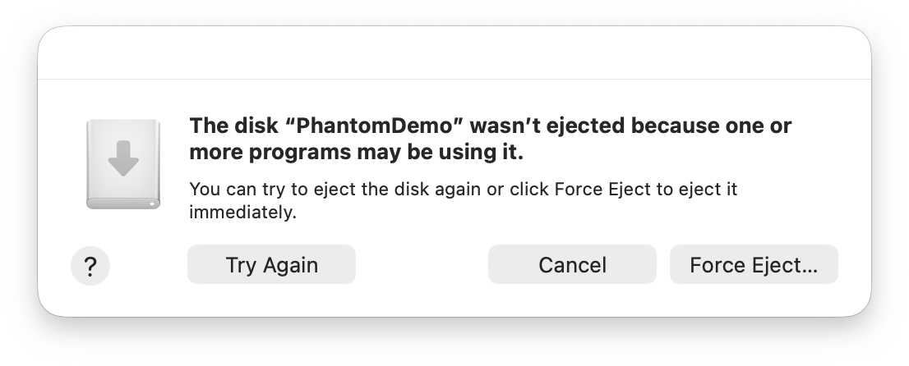
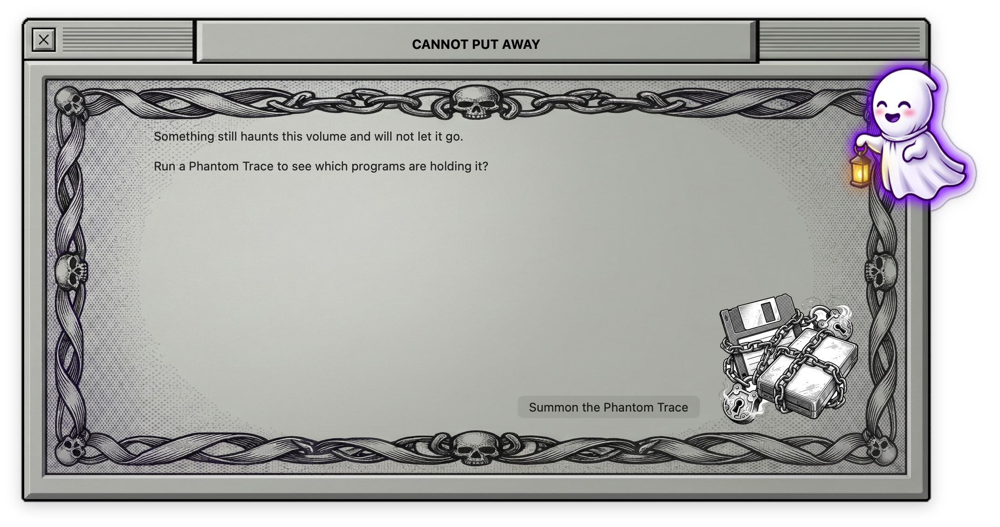
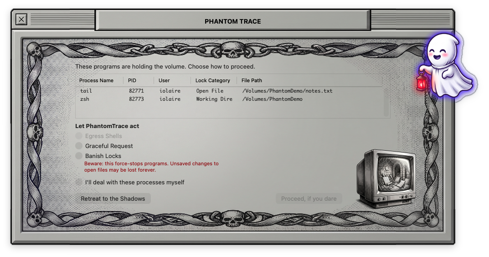
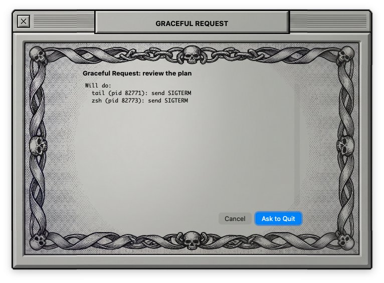
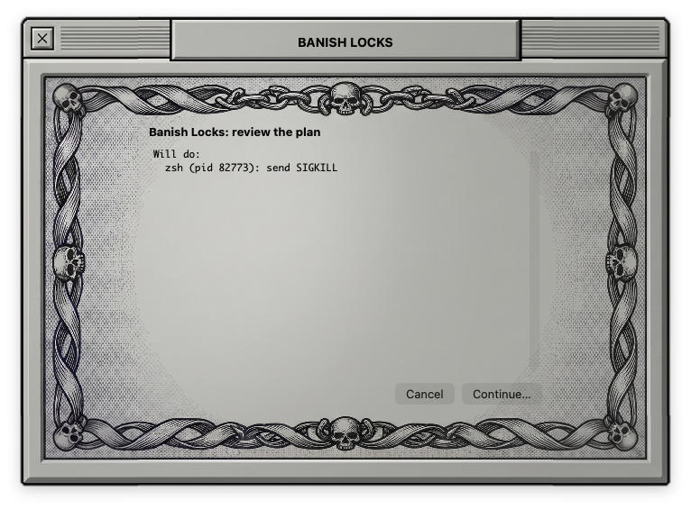
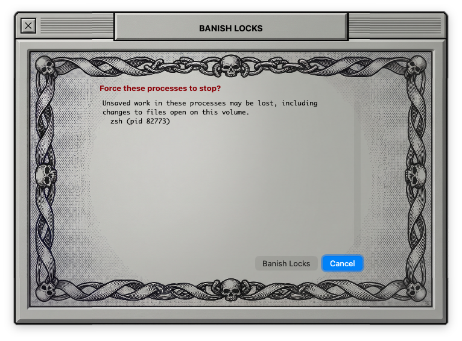
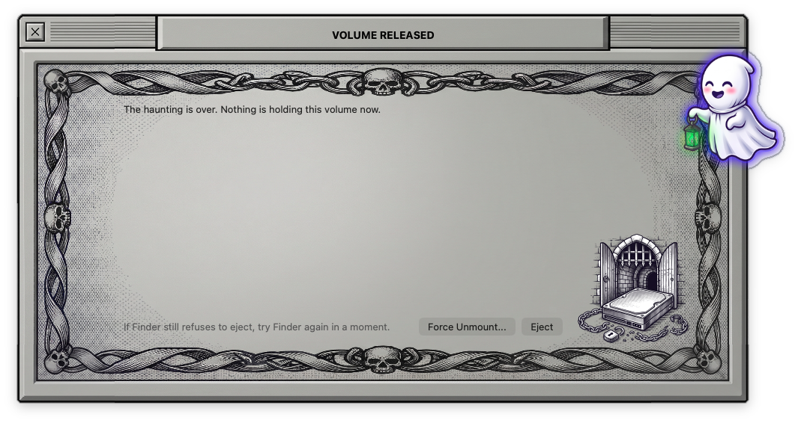

# PhantomTrace

**Volume Lock Forensics & Banishment**

A retro-themed macOS contextual forensic utility that demystifies Finder's opaque *"The disk wasn't ejected because one or more programs may be using it"* dialog by pinpointing the exact locking processes and open file handles, allowing users to safely resolve blockers and unmount external drives.

PhantomTrace is built for the Kiroween **Resurrection** category. See [docs/ProjectOverview.md](docs/ProjectOverview.md) for the full overview.

## The problem

When an external drive, USB stick, or disk image (`.dmg`) fails to unmount, Finder shows a generic error without naming the responsible application. Users end up running `lsof`, `fuser`, and `kill -9` by hand, or pulling the cable and risking filesystem corruption.

PhantomTrace shows what is blocking the volume and tells these cases apart:

- **Background system daemons:** Spotlight indexing (`mds`, `mdworker_shared`) and QuickLook satellites.
- **Current working directory (CWD) locks:** orphaned shells (`zsh`, `bash`, `node`) sitting inside a folder on the volume.
- **Active open file handles:** running apps holding read/write locks on specific files.

## How it works

- **Trigger:** a native Finder Quick Action (`Why Can't I Eject?` / `Inspect Volume Locks`) and a Desktop drop target. It is independent of any menu-bar widget.
- **Diagnostic sheet:** shows the volume name and path, and lists each offending process with its name, PID, user, lock category (CWD or open file handle), and exact file path.
- **Graduated resolution pipeline** (opt-in):
  1. Egress Shells: reset idle shell working directories (`cd ~`) without killing terminal sessions.
  2. Graceful Request: send AppKit quit / `SIGTERM` requests to active applications.
  3. Banish Locks: send a targeted `SIGKILL` to hung daemons or orphan workers.
  4. Clean Handoff: unmount through `DiskArbitration.framework` or `/usr/sbin/diskutil unmount` once no locks remain.

## Visual direction

Platinum Retro Gothic: a System 7 / Mac OS 9 platinum alert window (pinstripe title bars, Monaco/Chicago typography, 1px beveled frames) haunted by an original, Kiro-inspired ghost mascot. It resurrects classic single-purpose Mac diagnostic tools, such as *Put Away* inspectors and *What's Keeping Me?*, for the modern Darwin APFS kernel.

## Status

The code for every task in the master spec's build order is written (Core library, live adapters, `phantomtrace` CLI, AppKit app, Quick Action bundle, bundling script). What has and has not been checked:

- Verified on macOS during development: `swift build`, targeted `swift test` runs (unit and property tests), `swiftlint --strict`, the bundler (`Scripts/make-app.sh`) and its shell test, the Quick Action installer shell test, and a local-only integration test that attaches a throwaway disk image. See [docs/ProjectLog.md](docs/ProjectLog.md) for what was run for each change.
- The app works on macOS 27.2.1 (build 26B131). A Kiro-driven pass on 2026-11-13 (recorded in [docs/ManualQA.md](docs/ManualQA.md)) ran the Quick Action, the lock list, Egress Shells, Graceful Request, Banish Locks and the released state against a throwaway disk image, and produced the screenshots below. Before that, the owner reported a manual end-to-end pass on 2026-11-12 on a throwaway disk image: the "Why Can't I Eject?" Quick Action was added to Finder's right-click menu and used; the full window flow works with the forward and back buttons and the images in the right places; the menus work (including Quit); force-quitting apps works; and a two-stage quit works, where an agent (`agy`) running in the terminal is quit first, the rescan then shows `zsh` still locking the drive, and quitting that releases it.
- Also covered by unit and property tests: the main menu (Quit Cmd-Q, Close Window Cmd-W, Inspect... Cmd-O, File > Inspect Volume) and the drop window that lists mounted volumes with an Inspect button each (Requirement 19).
- **Not verified:** VoiceOver and Reduce Motion have not been tested. The drop-target path (dragging onto the window or Dock icon) and the drop window's volume list were not named in the owner's report, so treat them as unconfirmed until ticked in `docs/ManualQA.md`. The 100 ms main-actor bound is not measured. Notarization has not been attempted.
- Several behaviors are provisional and await the owner's confirmation; see [docs/architecture.md](docs/architecture.md#provisional-behaviors) and the known gaps in [docs/SubmissionChecklist.md](docs/SubmissionChecklist.md).
- Screenshots were captured on 2026-11-13 from the rebuilt app on macOS 27.2.1 against a throwaway disk image (see Screenshots below). No demo video exists yet. The app icon exists (`Packaging/AppIcon.icns`).

## Screenshots
Without PhantomTrace, Finder refuses to eject the same volume and names nothing:



Captured on macOS 27.2.1 from Finder's File > Eject on the demo image while the two helper locks were running. The dialog was dismissed with Cancel; Force Eject was not used.

With PhantomTrace:

Captured from `build/PhantomTrace.app` on macOS 27.2.1 (build 26B131) against a throwaway 20 MB disk image. The two locks were a `tail -f` on a file and an interactive `zsh` in the volume root, both started by the capture session. Only those two helper pids were ever signaled.

| State | Image |
|---|---|
| Cannot Put Away: the volume is held |  |
| Phantom Trace: process, pid, user, lock category, path |  |
| Graceful Request plan preview (SIGTERM, named by pid) |  |
| After the stage and rescan: `zsh` still holds the volume |  |
| Banish Locks plan preview (SIGKILL, named by pid) |  |
| Banish confirmation, Cancel is the default button |  |
| Volume Released: nothing holds the volume |  |

The button clicks were sent by script under macOS Accessibility permission that the owner granted for the capture. The Eject button and Force Unmount were not pressed in this run; the image was detached afterwards with `hdiutil detach`.

## Platform

PhantomTrace is **macOS only**. The code builds with a deployment target of **macOS 15.0 (Sequoia) or later** and is **tested only on macOS 27.2.1 (build 26B131)**. Other macOS versions from 15.0 up are best effort and untested; versions older than 15.0 do not build. It is not supported on Linux, Windows, or iOS.

## Build

Only the Command Line Tools are needed. There is no Xcode project, and `xcodebuild`, `actool`, and Interface Builder are not used.

Build the package:

```
swift build
```

Run the tests:

```
swift test
```

Enable the commit checks once per clone (lint, tests, project log, and `.kiro` guard on every commit):

```
Scripts/install-git-hooks.sh
```

SwiftLint is required for the checks: `brew install swiftlint`. On a Command Line Tools only machine, `swiftlint` may fail to load SourceKit unless `DYLD_FRAMEWORK_PATH=/Library/Developer/CommandLineTools/usr/lib` is set (and in some runs `SOURCEKIT_TOOLCHAIN_PATH=/Library/Developer/CommandLineTools`). `Scripts/lint-and-test.sh` sets `DYLD_FRAMEWORK_PATH` itself on Command Line Tools installs; set it yourself only when running `swiftlint` directly.

## Run

### CLI

The CLI is read-only: it resolves the volume and lists the locks. It never signals a process or unmounts anything.

```
swift run phantomtrace /Volumes/SomeDrive
swift run phantomtrace "phantomtrace://inspect?path=%2FVolumes%2FSomeDrive"
```
A real captured run against a throwaway disk image is in [docs/CliCapture.md](docs/CliCapture.md).

### App bundle

Build, sign (ad-hoc by default), and verify `build/PhantomTrace.app`:

```
Scripts/make-app.sh
open build/PhantomTrace.app
```

`make-app.sh` runs `swift build` for `PhantomTraceApp`, assembles the bundle in a staging directory, signs it with the hardened runtime, runs `codesign --verify --strict`, and replaces `build/PhantomTrace.app` only if that passes. On failure it prints the failed step to standard error, exits non-zero, and leaves an existing bundle unchanged. Set `SIGN_IDENTITY` to use a real identity instead of ad-hoc. The script does not notarize. The bundle has been built, verified, and launched (see Status).

**Gatekeeper.** The app is ad-hoc signed and not notarized, so `spctl --assess` rejects it. That does not affect a build you make yourself: a bundle produced by `make-app.sh` on your Mac is not quarantined and `open build/PhantomTrace.app` starts it (checked on macOS 27.2.1). Build from source as above. If you copy the app from another Mac or download it, macOS quarantines it; right-click it and choose Open, or run `xattr -dr com.apple.quarantine build/PhantomTrace.app`. That copied-app case has not been tested.

Opened with no file or URL, the app shows the drop window: drop a volume or folder on the left, or pick a mounted volume from the list on the right and choose Inspect (or press Return). The same volumes are under File > Inspect Volume, and File > Inspect... (Cmd-O) chooses any file, folder, or volume. Protected and system volumes are never listed. The list refreshes when a volume is mounted, unmounted, or renamed. Cmd-W closes the window without quitting; click the Dock icon to bring it back. Quit with Cmd-Q.

### Finder Quick Action

```
Scripts/install-quick-action.sh
```

Copies `Packaging/QuickAction/Why Can't I Eject?.workflow` into `~/Library/Services` and refreshes Services. It prints an error and exits non-zero on failure, and leaves any existing installation untouched. The shell test for the installer passes, but it has since been installed and seen in Finder on macOS 27.2.1.

After installing, enable it once: right-click any item in Finder, choose Quick Actions > Customize..., and tick "Why Can't I Eject?" (or go to System Settings > General > Login Items & Extensions > Finder). Until then macOS hides it from every right-click menu, including the drive's. Quick Actions do not appear in the Finder sidebar's menu; right-click the volume on the Desktop or in the Computer window.

### Optional manual notarization

Not required to run the app locally, and not done for this repository. `notarytool` and `stapler` are present with Command Line Tools (checked by `Scripts/spike-signing.sh`), but nothing has been submitted. To notarize a build signed with a Developer ID identity, using your own keychain profile:

```
ditto -c -k --keepParent build/PhantomTrace.app build/PhantomTrace.zip
xcrun notarytool submit build/PhantomTrace.zip --keychain-profile "<profile>" --wait
xcrun stapler staple build/PhantomTrace.app
```

## Built with Kiro

- **Specs** in `.kiro/specs/`: mount-point path resolution, process discovery state machines, and safe unmount workflows.
- **Property-based testing:** fuzz tests of the `lsof`/`fuser` output parser against malformed paths, non-UTF8 strings, spaces, and symlinks.
- **Agent hooks** in `.kiro/hooks/`: pre-commit checks that enforce swiftlint rules and require passing tests.
- **Steering files** in `.kiro/steering/`: eleven files (product, safety, tech, testing, and more). Some rules are enforced as lint rules; see KiroUsage for examples.
- **Kiro power:** `swift-expert` guided a Core concurrency audit (cancellation, async mount lookup; decision D-021) and general Swift Testing practice.

See [docs/KiroUsage.md](docs/KiroUsage.md) for how each Kiro feature was used.

## Hackathon submission

- Category: Resurrection. Hackathon: Kiroween 2026.
- [Submission checklist](docs/SubmissionChecklist.md)
- [Demo script](docs/demo-script.md)
- Pre-existing code: none. The project was created during the Submission Period.
- Prior work disclosure: the only carry-over from the owner's 2025 Kiroween entry, West of House, is the idea of an image-prompt style (dark-fantasy woodcut pen-and-ink with crosshatching). That prompt was run fresh on Google Gemini to generate new art for this project. No West of House code, image files, or other assets are in this repository. See [docs/Assets.md](docs/Assets.md).
- Runtime dependencies: none. swift-property-based and SwiftLint are development tools only.

## Documentation

- [Architecture](docs/architecture.md): layers, data flow, pipeline, safety model, implementation status
- [Project log](docs/ProjectLog.md): work, tools, and decisions
- [Look and feel](docs/LookAndFeel/README.md): visual design reference
- [docs index](docs/README.md)

## Specs

- [Project overview](docs/ProjectOverview.md)
- [Master spec: PhantomTrace volume lock forensics](.kiro/specs/phantomtrace-volume-lock-forensics/)
- [Project scaffolding spec](.kiro/specs/project-scaffolding/)

## License

PhantomTrace is released under the MIT License. See [LICENSE](LICENSE).
