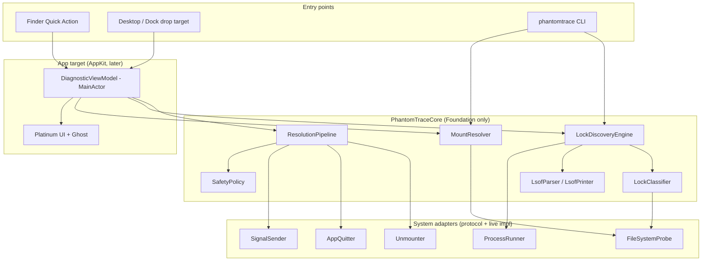
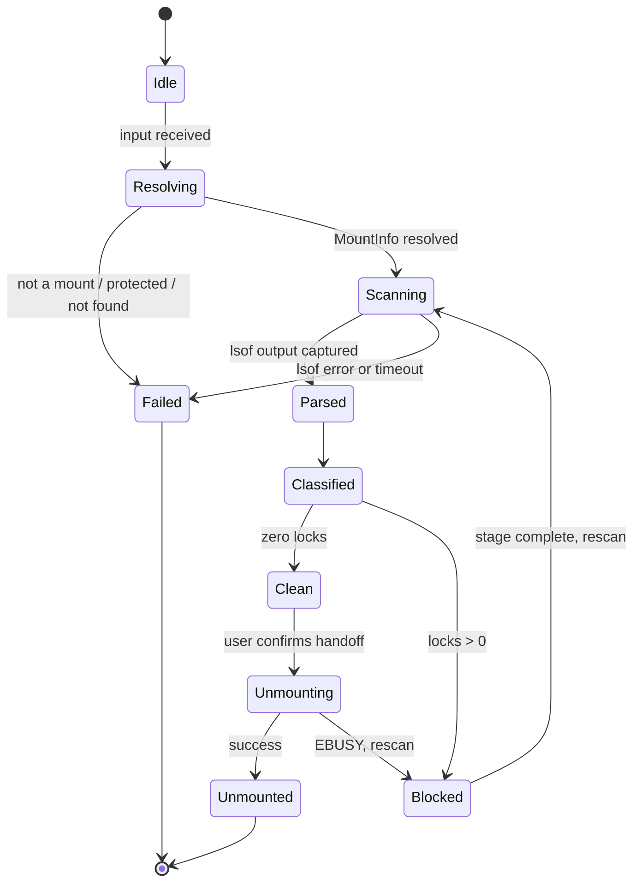

# Architecture

This is the working summary of how PhantomTrace is put together. The authoritative, detailed design (interfaces, data models, pseudocode, and the 21 correctness properties) is the master spec:
[PhantomTrace design](../.kiro/specs/phantomtrace-volume-lock-forensics/design.md), with requirements in [requirements.md](../.kiro/specs/phantomtrace-volume-lock-forensics/requirements.md). If this page and the spec disagree, the spec wins; fix this page.

For the product pitch see [ProjectOverview.md](ProjectOverview.md). For the rules code must follow see `.kiro/steering/` (`structure.md`, `safety.md`, `testing.md`, `macos-platform.md`).

## Implementation status

"Written" means the code and its tests exist and were built and run on macOS during development. "Run by hand" means someone launched it and watched it work. Only the pieces marked that way have been seen working outside tests.

| Piece | Status |
|---|---|
| SwiftPM package, lint, hooks, scripts | Done |
| Core models, system-effect protocols, shared mocks (`PhantomTraceTestSupport`) | Written, tested |
| `LsofParser`/`LsofPrinter`, `LockClassifier`, `MountResolver`, `SafetyPolicy`, `LockDiscoveryEngine` and reducer | Written, unit and property tested |
| `ResolutionPipeline` (plan, execute, rescan), Egress Shells performer, Clean Handoff | Written, unit and property tested with mocks. Never run against real processes |
| Live adapters (`LiveProcessRunner`, mount table, `.dmg` mapping, signal sender, process inspector, `LiveUnmounter`, terminal scripting) | Written. Unit tested with injected calls. The unmount and discovery path was exercised once by the local-only disk image integration test; signals and terminal scripting were not run for real |
| `phantomtrace` CLI (read-only inspect) | Written, unit tested. Not run by hand against a real locked volume |
| Presentation model (`WindowModel`, `selectWindow`, `DiagnosticCoordinator`, `PathTruncation`) | Written, unit and property tested |
| `PhantomTraceUI` AppKit views, `PhantomTraceApp`, drop target, URL handler, Services entry, accessibility labels | Written, app-side logic unit tested. **The app has never been launched**, so layout, drawing, VoiceOver, and Reduce Motion are unverified |
| Sprites (1x/2x export from `docs/LookAndFeel/use/`) | Exported and checked by `Scripts/verify-sprites.sh`. Not seen in the app |
| Quick Action `.workflow` and `Scripts/install-quick-action.sh` | Written. Installer shell test passes with a temporary `HOME`. Not tried in Finder |
| `Scripts/make-app.sh` bundler | Built, signed ad-hoc with hardened runtime, and verified; shell test passes. Not notarized, not launched |
| App icon, Title_Font, screenshots, demo video | Not created |

Update this table in the same commit that changes it.

## Package layout

- `PhantomTraceCore` (library): all logic, Foundation only; live adapters under `System/`.
- `PhantomTraceUI` (library): AppKit views and window composition, `@MainActor`. Split from the app so UI logic can be tested without importing an executable.
- `PhantomTraceApp` (executable): thin `AppDelegate`, live `AppQuitter`, and the composition root.
- `phantomtrace` (executable): the CLI.
- `PhantomTraceTestSupport` (not a product): hand-written mocks shared by the unit and property test targets.
- Tests: `PhantomTraceCoreTests`, `PhantomTraceUITests`, `PhantomTracePropertyTests`, plus shell tests under `Tests/Scripts`.

The split and the test-support target are stated in the master spec's tasks.md; a decision entry in [ProjectLog.md](ProjectLog.md) is still to be added.

## System overview

## Layers and rules

1. **Core** (`Sources/PhantomTraceCore`) holds all logic. It imports Foundation only; Darwin, DiskArbitration, and OSLog appear only in live adapters under `System/`. It never imports AppKit.
2. **System adapters** are protocols (`ProcessRunning`, `SignalSending`, `AppQuitting`, `Unmounting`, `FileSystemProbing`) with live implementations. Tests replace them with mocks, so tests never touch the real system.
3. **Entry targets** (CLI now, app later) depend on Core and wire live adapters at the composition root. Core never depends on them.
4. **Pure logic** (parser, printer, classifier, safety policy, plan building, path matching, URL parsing, middle truncation) performs no I/O and is the target of the property tests.

Directory layout is in `.kiro/steering/structure.md`.

## Data flow

1. **Input.** A path arrives from the Quick Action (`phantomtrace://inspect?path=<percent-encoded>`), a drop, or a CLI argument. URLs are percent-decoded, canonicalized, length-limited, and rejected if malformed.
2. **Resolve.** `MountResolver` canonicalizes (symlinks, firmlinks), finds the owning mount by longest whole-component prefix, maps an attached `.dmg` to its volume, and refuses protected volumes (`/`, `/System/Volumes/*`, `/private/var/vm`) with `protectedVolume`.
3. **Discover.** `LockDiscoveryEngine` runs `/usr/sbin/lsof -F pcLnftau0 -w +f -- <mountpoint>` through `ProcessRunner` (15 s timeout), falls back to `lsof +D` plus `fuser -c` on truncation or timeout (partial results flagged), merges duplicate (pid, path) rows, and drops PhantomTrace's own pid.
4. **Parse.** `LsofParser` is total over arbitrary bytes. It keeps `pathBytes` as the source of truth, decodes `\` escapes, emits `ParseWarning`s instead of failing, and tolerates unknown fields and truncated tails.
5. **Classify.** `LockClassifier` assigns a `LockCategory` (`cwd` or `openFileHandle`) and a `ProcessRole` (`systemDaemon`, `idleShell`, `userApplication`, `cliTool`, `unknown`), drops paths that do not resolve under the volume (including symlink escapes), and records process start time for identity checks.
6. **Present.** The Diagnostic Sheet (or CLI output) lists Process Name, PID, User, Lock Category, and File Path.
7. **Resolve locks.** The user opts into stages one at a time (below). Every stage plans from a fresh scan, shows the plan, executes only what `SafetyPolicy` approves, then rescans.

## Discovery state machine

The ghost mascot follows this state: idle (idle, scanning), haunting (Blocked), banished (clean, unmounted).

## Resolution pipeline

| Stage | Acts on | Action | Notes |
|---|---|---|---|
| 1. Egress Shells | Idle shells with a `cwd` lock | Send the fixed literal ` cd ~\n` to a scriptable terminal | Never kills the shell; otherwise marked manual with instructions |
| 2. Graceful Request | GUI apps, then non-GUI non-protected processes | `quitApplication`, else `SIGTERM` | Waits the grace period (default 5 s, 1 to 60 s), records a graceful attempt per process identity |
| 3. Banish Locks | Processes that survived a recorded graceful attempt | `SIGKILL` | Lists name and pid, needs explicit confirmation, re-verifies identity |
| 4. Clean Handoff | The volume | DiskArbitration unmount, one `diskutil unmount` fallback | Only after a fresh scan shows zero locks; non-forced unless the advanced confirmation is given; busy returns to Blocked |

## Safety model

`SafetyPolicy` is the single approval path. It denies protected processes (pid 0 and 1, own pid, `launchd`, `kernel_task`, `WindowServer`, `loginwindow`, `Finder`), other users' processes without authorization, `SIGKILL` without a prior graceful attempt, and anything it cannot determine. Signals are sent only if `(pid, start time)` still matches discovery. Subprocesses use argument arrays with absolute executable paths and timeouts, never a shell. There is no network access and no telemetry. Details: `.kiro/steering/safety.md` and master spec Requirements 6 and 15.

## Window states and assets

The UI is three Platinum windows over the discovery state, selected by the pure `selectWindow` function (design section "Window States"). Resource files are copied flat into `Contents/Resources` by `Scripts/make-app.sh`; they are plain PNGs, not an asset catalog.

| Window state | Title plaque | Illustration | Ghost | Shown when |
|---|---|---|---|---|
| `cannotPutAway` | CANNOT PUT AWAY | `shackled-volume-and-padlocks` | `ghost-looking-left-yellow` | First scan reports locks |
| `phantomTrace` | PHANTOM TRACE | `crt-diagnostic-portal` | `ghost-looking-left-red` | After Proceed, during stages and rescans, failed or partial scans |
| `volumeReleased` | VOLUME RELEASED | `shattered-chains-and-portullis` | `ghost-looking-left-green` | Fresh scan reports zero locks, or the volume is unmounted |

All sprites ship as `name.png` plus `name@2x.png`; the window frame also has `window-frame.insets.json` for the 9-slice. The ghost is derived from the window, never set on its own. Provenance and licenses: [Assets.md](Assets.md).

## Packaging findings (spike, task 1.1)

`Scripts/spike-signing.sh` was run on the dev Mac (Command Line Tools only) and reported: `swift build` ok, ad-hoc `codesign` with the hardened runtime ok, `codesign --verify` ok, the signed binary runs, and `notarytool` and `stapler` are both present under `/Library/Developer/CommandLineTools/usr/bin`. Nothing was submitted to Apple, so notarization itself is untested. The script cleans up its temp directory.

## Provisional behaviors

18.15 is no longer provisional: the owner chose a Go Back button ("Retreat to the Shadows") in `phantomTrace` only, which returns to `cannotPutAway` without scanning or signalling (D-019).

The rest follow the design's provisional proposals and are marked `// PROVISIONAL (Req 18.x)` in the code. They await the owner's confirmation and are easy to change.

| Req | Behavior |
|---|---|
| 18.6 | No window content during Idle, Resolving, or a resolve failure (alert only) |
| 18.7 | First scan shows the frame with a Scanning_Overlay only after 500 ms |
| 18.16 | "I'll deal with these processes myself" plus Proceed does a fresh rescan only and sends no signal |
| 18.21, 18.23 | Eject plus a Finder-retry note while the volume is mounted; message only once unmounted |
| 18.26 | A failed or partial scan shows `phantomTrace` with a banner and Rescan, with stage options disabled |

## Known gaps and deviations from the design

Recorded so nothing reads as finished that is not:

- `ResolutionPipeline` does not pass user-confirmed system daemons through to plan building, so the "user-confirmed `systemDaemon`" exception for `SIGKILL` cannot be exercised from the pipeline.
- `StageOutcome` cannot represent a manual Egress Shells result (terminal automation denied or unsupported, shell left for the user to handle), so those cases are not reported as manual.
- `Banner` has no field for partial vs failed. The window controller infers the kind from the coordinator's message prefix, which is fragile.
- The app has not been launched. Layout, the end-to-end flow, the Quick Action in Finder, the drop target, VoiceOver, and Reduce Motion are unverified, and `windowAnnouncement` is not posted yet.
- `swiftlint` needs `DYLD_FRAMEWORK_PATH=/Library/Developer/CommandLineTools/usr/lib` on this machine.
- The disk image integration test covers discover then unmount; it does not drive the full pipeline.
- Parser fixtures are generated, not captured from real `lsof` output.

## Testing approach

Unit tests use mock adapters and captured `lsof` fixtures. Property tests (swift-property-based, at least 500 iterations) cover parser totality, round-trip, byte fidelity, truncation safety, classification, mount resolution, safety rules, plan construction, unmount gating, URL round-trip, and truncation. A local-only integration test uses a temporary disk image. Details: `.kiro/steering/testing.md`.

## Platform and packaging

macOS 27.2.1 (build 26B131) only. The app cannot use App Sandbox because it needs `lsof` and signals, so it ships with Hardened Runtime and minimal entitlements. Terminal automation needs the user's Automation permission and degrades to manual instructions. Details: `.kiro/steering/macos-platform.md`.

## Visual design

Platinum Retro Gothic. Reference art is in [LookAndFeel](LookAndFeel/README.md); UI rules are in `.kiro/steering/platinum-ui.md`.
