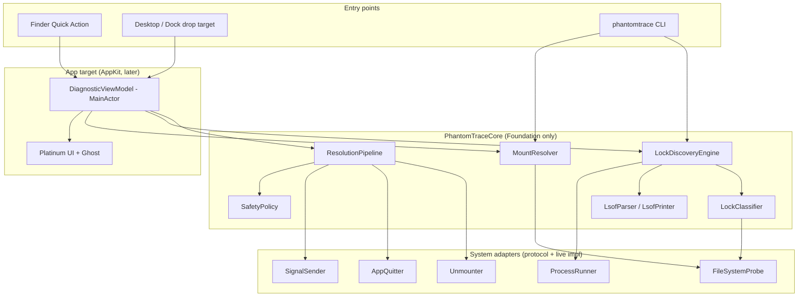
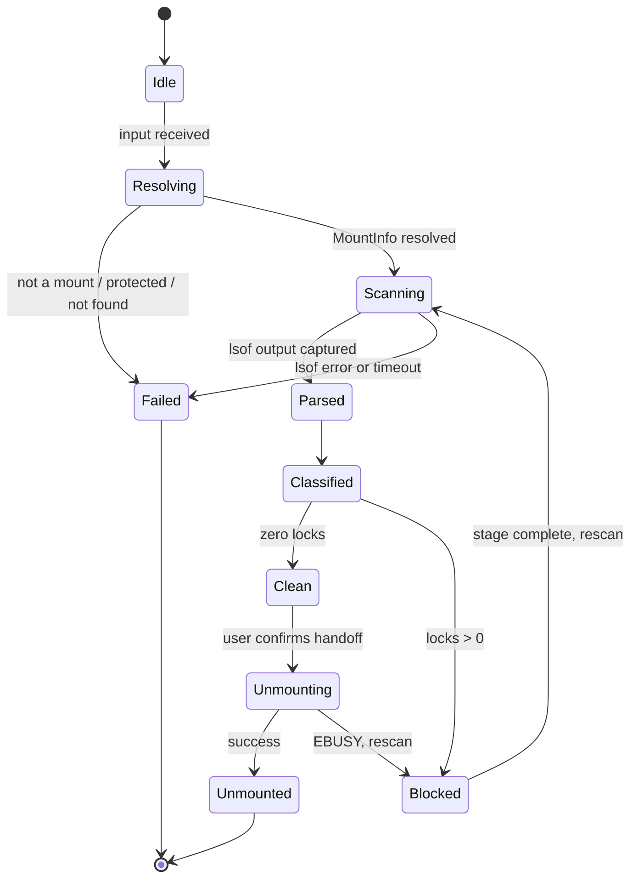

# Architecture

This is the working summary of how PhantomTrace is put together. The authoritative, detailed design (interfaces, data models, pseudocode, and the 21 correctness properties) is the master spec:
[PhantomTrace design](../.kiro/specs/phantomtrace-volume-lock-forensics/design.md), with requirements in [requirements.md](../.kiro/specs/phantomtrace-volume-lock-forensics/requirements.md). If this page and the spec disagree, the spec wins; fix this page.

For the product pitch see [ProjectOverview.md](ProjectOverview.md). For the rules code must follow see `.kiro/steering/` (`structure.md`, `safety.md`, `testing.md`, `macos-platform.md`).

## Implementation status

| Piece | Status |
|---|---|
| SwiftPM package, CLI stub (prints the version), placeholder tests, lint, hooks, scripts | Done (scaffolding) |
| Models, `LsofParser`/`LsofPrinter`, `LockClassifier`, `MountResolver`, `LockDiscoveryEngine`, `SafetyPolicy`, `ResolutionPipeline`, `Unmounter` | Not started (directories hold only `.gitkeep`) |
| CLI inspect command | Not started |
| AppKit app, Platinum UI, Quick Action, drop target | Not started |

Update this table in the same commit that changes it.

## System overview

## Layers and rules

1. **Core** (`Sources/PhantomTraceCore`) holds all logic. It imports Foundation only; Darwin, DiskArbitration, and OSLog appear only in live adapters under `System/`. It never imports AppKit.
2. **System adapters** are protocols (`ProcessRunning`, `SignalSending`, `AppQuitting`, `Unmounting`, `FileSystemProbing`) with live implementations. Tests replace them with mocks, so tests never touch the real system.
3. **Entry targets** (CLI now, app later) depend on Core and wire live adapters at the composition root. Core never depends on them.
4. **Pure logic** (parser, printer, classifier, safety policy, plan building, path matching, URL parsing, middle truncation) performs no I/O and is the target of the property tests.

Directory layout is in `.kiro/steering/structure.md`.

## Data flow

1. **Input.** A path arrives from the Quick Action (`phantomtrace://inspect?path=<percent-encoded>`), a drop, or a CLI argument. URLs are percent-decoded, canonicalized, length-limited, and rejected if malformed.
2. **Resolve.** `MountResolver` canonicalizes (symlinks, firmlinks), finds the owning mount by longest whole-component prefix, maps an attached `.dmg` to its volume, and refuses protected volumes (`/`, `/System/Volumes/*`, `/private/var/vm`) with `protectedVolume`.
3. **Discover.** `LockDiscoveryEngine` runs `/usr/sbin/lsof -F pcLnftau0 -w +f -- <mountpoint>` through `ProcessRunner` (15 s timeout), falls back to `lsof +D` plus `fuser -c` on truncation or timeout (partial results flagged), merges duplicate (pid, path) rows, and drops PhantomTrace's own pid.
4. **Parse.** `LsofParser` is total over arbitrary bytes. It keeps `pathBytes` as the source of truth, decodes `\` escapes, emits `ParseWarning`s instead of failing, and tolerates unknown fields and truncated tails.
5. **Classify.** `LockClassifier` assigns a `LockCategory` (`cwd` or `openFileHandle`) and a `ProcessRole` (`systemDaemon`, `idleShell`, `userApplication`, `cliTool`, `unknown`), drops paths that do not resolve under the volume (including symlink escapes), and records process start time for identity checks.
6. **Present.** The Diagnostic Sheet (or CLI output) lists Process Name, PID, User, Lock Category, and File Path.
7. **Resolve locks.** The user opts into stages one at a time (below). Every stage plans from a fresh scan, shows the plan, executes only what `SafetyPolicy` approves, then rescans.

## Discovery state machine

The ghost mascot follows this state: idle (idle, scanning), haunting (Blocked), banished (clean, unmounted).

## Resolution pipeline

| Stage | Acts on | Action | Notes |
|---|---|---|---|
| 1. Egress Shells | Idle shells with a `cwd` lock | Send the fixed literal ` cd ~\n` to a scriptable terminal | Never kills the shell; otherwise marked manual with instructions |
| 2. Graceful Request | GUI apps, then non-GUI non-protected processes | `quitApplication`, else `SIGTERM` | Waits the grace period (default 5 s, 1 to 60 s), records a graceful attempt per process identity |
| 3. Banish Locks | Processes that survived a recorded graceful attempt | `SIGKILL` | Lists name and pid, needs explicit confirmation, re-verifies identity |
| 4. Clean Handoff | The volume | DiskArbitration unmount, one `diskutil unmount` fallback | Only after a fresh scan shows zero locks; non-forced unless the advanced confirmation is given; busy returns to Blocked |

## Safety model

`SafetyPolicy` is the single approval path. It denies protected processes (pid 0 and 1, own pid, `launchd`, `kernel_task`, `WindowServer`, `loginwindow`, `Finder`), other users' processes without authorization, `SIGKILL` without a prior graceful attempt, and anything it cannot determine. Signals are sent only if `(pid, start time)` still matches discovery. Subprocesses use argument arrays with absolute executable paths and timeouts, never a shell. There is no network access and no telemetry. Details: `.kiro/steering/safety.md` and master spec Requirements 6 and 15.

## Testing approach

Unit tests use mock adapters and captured `lsof` fixtures. Property tests (swift-property-based, at least 500 iterations) cover parser totality, round-trip, byte fidelity, truncation safety, classification, mount resolution, safety rules, plan construction, unmount gating, URL round-trip, and truncation. A local-only integration test uses a temporary disk image. Details: `.kiro/steering/testing.md`.

## Platform and packaging

macOS 27.2.1 (build 26B131) only. The app cannot use App Sandbox because it needs `lsof` and signals, so it ships with Hardened Runtime and minimal entitlements. Terminal automation needs the user's Automation permission and degrades to manual instructions. Details: `.kiro/steering/macos-platform.md`.

## Visual design

Platinum Retro Gothic. Reference art is in [LookAndFeel](LookAndFeel/README.md); UI rules are in `.kiro/steering/platinum-ui.md`.
